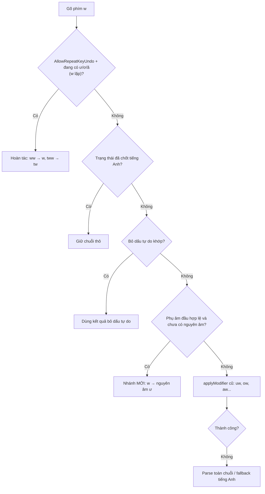

<!--
  BambooMintKey - Vietnamese Telex Input Method Editor for Windows
  Copyright (c) 2026 Dương Gia Long and LMO contributors
  SPDX-License-Identifier: MIT
-->

# 011_01 — Thiết Kế: Hợp Nhất Phím `w → ư` Ở Mọi Vị Trí Trong Từ (`AllowLeadingWAsU`)

**Mã tài liệu:** `011_01_W_As_U_Anywhere_Design`

**Giai đoạn:** Phase 11 — Mở rộng trải nghiệm gõ Telex

**Thuộc module:** `BambooMintKey.Core` (`Engine/TelexEngine.fs`)

**Trạng thái:** ✅ Đã triển khai trong `TelexEngine.fs` và có test. Tài liệu này được viết **sau** khi code xong, để mô tả lại thiết kế và lý do. Cần rà soát lại cùng code.

**Tài liệu tham chiếu:**

- Lỗi gốc của tính năng `w` đầu từ: [019_LeadingW_As_U_Bilingual_Conflict_And_Undo_Fix.md](../../3.Issue/019_LeadingW_As_U_Bilingual_Conflict_And_Undo_Fix.md)
- Mở rộng âm tiết sau modifier (`Uwu → Ưu`): [005_01_Uppercase_Modifier_Syllable_Design.md](../Phase5/005_01_Uppercase_Modifier_Syllable_Design.md)
- Bỏ dấu tự do: [005_00_Free_Tone_Placement_Design.md](../Phase5/005_00_Free_Tone_Placement_Design.md)
- Bảo vệ từ tiếng Anh: [005_02_English_Word_Telex_Protection.md](../Phase5/005_02_English_Word_Telex_Protection.md)

---

## 1. Bối Cảnh Và Mục Tiêu

### 1.1. Hiện trạng trước khi thay đổi

Tuỳ chọn **"Phím `w` biến thành `ư`"** (`AllowLeadingWAsU`) trước đây chỉ có tác dụng khi `w` là **phím đầu tiên** của từ:

- Có tác dụng: `w → ư`, `wa → ưa`, `ws → ứ`, `wowng → ương`.
- Không có tác dụng: `trw`, `thw`, `nhw`, `hw`... vẫn ra chữ thô (`trw`, `thw`...). Người dùng muốn gõ "trường" hay "như" phải gõ `truwowngf`, `nhuw`.

Lý do ban đầu giới hạn ở đầu từ là để **giảm độ phức tạp** khi làm tính năng lần đầu (xem 019).

### 1.2. Mục tiêu

1. **Hợp nhất tính năng**: không còn phân biệt `w` ở đầu từ hay giữa từ. Chỉ có một quy tắc duy nhất: *"khi `w` không gắn được vào nguyên âm nào và phần đã gõ chỉ mới có phụ âm đầu, `w` trở thành nguyên âm `ư`"*.
2. Gõ được các từ dạng phụ âm + `ư`: `tw → tư`, `thw → thư`, `nhwng → nhưng`, `trwowngf → trường`...
3. **Không phá vỡ** hành vi hiện có: `uw → ư`, `ow → ơ`, `aw → ă`, `ww` hoàn tác, bỏ dấu tự do, bảo vệ từ tiếng Anh.
4. Không thêm cờ cấu hình mới. Dùng lại `AllowLeadingWAsU` nên **không phải đổi** layout shared memory, JSON, Fcitx5, UI Linux/Mac.

### 1.3. Ngoài phạm vi

- `w` đứng **sau** phần nguyên âm hoặc phụ âm cuối (ví dụ `wongw → ương`, đã chạy trước đó). Phần này không thay đổi.
- Đổi tên cờ `AllowLeadingWAsU`. Tên cũ giữ nguyên để tương thích file cấu hình và C-ABI. Chỉ đổi **nhãn hiển thị**.
- Kiểu gõ khác (VNI, VIQR) và các phím `[`, `]`.

---

## 2. Nghiên Cứu Tham Khảo

| Bộ gõ | Quan sát |
|---|---|
| **Bamboo (`bamboo-core`)** | Telex định nghĩa `"w": "UOA_ƯƠĂ"` (xác nhận trực tiếp từ `input_method_def.go`). Cách Bamboo xử lý `w` khi không gắn được vào nguyên âm (append thành `ư` rồi kiểm tra âm tiết có hợp lệ không) là kiến thức về kiến trúc, **chưa đối chiếu được dòng code cụ thể**. |
| **UniKey** | Chưa đọc source. Theo tài liệu người dùng, `w` sau phụ âm cho `ư` (`tw → tư`, `thw → thư`) và gây lỗi dính chữ với từ tiếng Anh như *twin*. UniKey có kiểu **Simple Telex** để tắt hành vi này. Đây là thông tin thứ cấp. |

**Nguyên tắc rút ra, và cách BambooMintKey áp dụng:**

1. *Ưu tiên gắn `w` vào nguyên âm đã có.* Giữ nguyên toàn bộ luồng `applyModifier` hiện tại.
2. *Chỉ khi không nguyên âm nào nhận mới thành `ư`.* Đây là nhánh mới.
3. *Kiểm tra chính tả trước khi biến đổi.* BambooMintKey kiểm tra ngay trên **phụ âm đầu** bằng một bảng cho phép, thay vì thử rồi mới huỷ.
4. *Gõ lặp để hoàn tác.* Dùng lại cơ chế undo modifier.

---

## 3. Phân Tích Nguyên Nhân Hiện Trạng

Lấy ví dụ gõ `t`, `h`, `w` (mong đợi `thư`):

1. Gõ `t`, `h`: `SyllableParser.parse` trả `None` vì chưa có nguyên âm. Engine giữ `Syllable = None`, hiển thị chuỗi thô `th`.
2. Gõ `w`:
   - `state.Syllable = None` nên không có âm tiết để áp modifier.
   - Nhánh cũ `w → ư` chỉ khớp khi `RawKeys` rỗng, không khớp.
   - Luồng parse toàn chuỗi thất bại (`w` không phải nguyên âm).
   - Rơi vào fallback tiếng Anh, ra `thw`.

Còn trường hợp `dd + w` (`đư`): sau `dd`, engine giữ một `Syllable` có `InitialConsonant = "đ"` nhưng `VowelNucleus` rỗng. `applyModifier` trả `None` vì không có nguyên âm, nên `w` cũng rơi vào fallback.

**Kết luận:** cả hai trường hợp đều thuộc cùng một dạng: *âm tiết mới chỉ có phụ âm đầu, không có nguyên âm nào để `w` gắn vào*. Chỉ cần xử lý đúng dạng này.

---

## 4. Thiết Kế Giải Pháp

### 4.1. Quy tắc chính

Khi người dùng gõ phím `w` (hoa hoặc thường), tuỳ chọn `AllowLeadingWAsU` đang bật, và **âm tiết hiện tại chưa có nguyên âm và chưa có phụ âm cuối**, và **phụ âm đầu thuộc danh sách cho phép đi với `ư`**, thì engine tạo ra một âm tiết mới gồm:

- phụ âm đầu: giữ nguyên các phím đã gõ (giữ hoa/thường),
- nguyên âm: `ư` (hoặc `Ư` nếu phím `w` vừa gõ là chữ hoa),
- không có phụ âm cuối, không có dấu thanh,
- ghi nhận dấu móc (Horn) do phím `w` tạo ra.

Quy tắc này **không có trường hợp riêng cho đầu từ**: đầu từ chính là trường hợp phụ âm đầu rỗng.

### 4.2. Thứ tự ưu tiên của phím `w`

Nhánh mới đứng **trước** `applyModifier` trong luồng gia tăng, nhưng chỉ kích hoạt khi âm tiết **chưa có nguyên âm**. Lúc đó `applyModifier` vốn đã thất bại, nên nhánh mới **không cướp** trường hợp nào mà luồng cũ xử lý được (`uw`, `ow`, `aw`).

### 4.3. Bảng phụ âm đầu cho phép

| Nhóm | Phụ âm đầu |
|---|---|
| **Cho phép** | *(rỗng = đầu từ)*, `b`, `c`, `ch`, `d`, `đ`, `g`, `gi`, `h`, `kh`, `l`, `m`, `n`, `ng`, `nh`, `ph`, `r`, `s`, `t`, `th`, `tr`, `v`, `x` |
| **Loại trừ** | `k`, `qu`, `gh`, `ngh`, `p` đơn |

Lý do loại trừ: chính tả tiếng Việt không có `kư`, `quư`, `ghư`, `nghư`, `pư`. Khi gặp các phụ âm này, `w` giữ nguyên chữ `w` thô (hành vi cũ), nên không sinh ra âm tiết sai.

Việc so khớp **không phân biệt hoa thường**. Phụ âm đầu trong âm tiết được tạo ra giữ nguyên hoa thường người dùng đã gõ (`Tr`, `TR`, `tr`).

> Lưu ý `gi`: cho phép `giư` vì tiếng Việt có `giữ`, `giừ`. Do `gi` cũng là phụ âm đầu nên `giw` không bị nhầm sang `g + iw`.

### 4.4. Hai dạng trạng thái đầu vào của nhánh mới

Engine lưu âm tiết hiện tại trong `state.Syllable`. Nhánh mới phải chấp nhận cả hai dạng, vì chúng đại diện cho cùng một tình huống "chỉ có phụ âm đầu":

| Dạng | Khi nào xảy ra | Cách lấy phụ âm đầu |
|---|---|---|
| `Syllable = None` | Gõ phụ âm thường (`t`, `th`, `tr`, `ng`...). Parser chưa nhận âm tiết vì thiếu nguyên âm. | Ghép toàn bộ `RawKeys` đã gõ thành chuỗi. Nếu `RawKeys` rỗng thì phụ âm đầu rỗng (đầu từ). |
| `Syllable = Some` nhưng `VowelNucleus` và `FinalConsonant` đều rỗng | Sau `dd → đ` (và `Dd → Đ`). | Lấy từ `InitialConsonant` của âm tiết (`đ`, `Đ`). |

Với dạng `None`, **toàn bộ** `RawKeys` phải khớp một phụ âm đầu cho phép. Ví dụ `RawKeys = "tr"` khớp, còn `RawKeys = "tsr"` hoặc `"str"` không khớp, nên không biến thành `ư`.

### 4.5. Các bước sau khi đã có `ư`

Âm tiết mới là một âm tiết bình thường có nguyên âm `ư`, nên các phím tiếp theo đi qua luồng đã có sẵn, **không cần code bổ sung**:

| Phím tiếp theo | Cơ chế dùng lại | Ví dụ |
|---|---|---|
| Nguyên âm `o` | Hòa hợp móc `ư + o → ươ` (`tryExtendSyllableWithChar`) | `tw`+`o` → `tươ` |
| Nguyên âm khác (`a`, `i`, `u`) | Mở rộng cụm nguyên âm hợp lệ | `mw`+`a` → `mưa` |
| `w` thứ hai sau `ươ` | `applyModifier` thấy `ươ` đã đủ móc và bỏ qua | `trwow` giữ `trươ` |
| Phụ âm cuối `c m n p t`, `ng`, `ch`, `nh` | Ghép phụ âm cuối | `nhw`+`ng` → `nhưng` |
| Dấu thanh `s f r x j` | `applyTone` đặt dấu theo kiểu Modern/Traditional | `tw`+`f` → `từ` |

### 4.6. Hoa thường

- Phím `w` thường tạo `ư`, phím `W` hoa tạo `Ư`.
- Sau đó toàn bộ chuỗi đi qua `WordBuffer.applyCase` như mọi âm tiết khác, nên `Tw → Tư`, `TW → TƯ`.
- Với trường hợp hoa thường lẫn lộn (ví dụ `tW`), kết quả theo quy tắc `detectCase` hiện có của engine. Tài liệu này không đặt quy tắc riêng.

---

## 5. Hoàn Tác (Undo) Và Backspace

### 5.1. Gõ lặp `w` để hoàn tác

Không cần thêm code. Phân tích luồng `t`, `w`, `w`:

1. Sau `tw` âm tiết là `tư`, `TransformedText = "tư"`.
2. Phím `w` thứ hai: điều kiện hoàn tác modifier thoả (`tư` có `u` mang móc, không có `o` mang móc, không có `o` trơn).
3. Nhánh `isLeadingW` **không** áp dụng vì phím đầu tiên là `t`, không phải `w`.
4. Vì `w` lặp liền kề, `RawKeys` rút về `tw` (bỏ phím `w` thừa) và đánh dấu `IsEnglishCommitted`.

Kết quả `tww → tw`. Từ đây các phím tiếp theo giữ chuỗi thô (ví dụ `twin` ra `twin`), phù hợp với cách `ww`, `ss`, `dd` hoàn tác hiện nay.

Với `w` ở đầu từ (`ww → w`, `Ww → Uw`, `wW → uW`) vẫn đi qua nhánh `isLeadingW` cũ, **không thay đổi**.

### 5.2. Backspace

Engine xử lý Backspace bằng cách **phát lại** toàn bộ `RawKeys` còn lại qua `handleCharInput`. Vì nhánh mới là một phần của `handleCharInput`, nên Backspace tự nhiên đúng: xoá `w` trong `thw` sẽ phát lại `t`, `h` và quay về `th`.

---

## 6. Tương Tác Với Các Tính Năng Khác

| Tính năng | Tác động | Kết luận |
|---|---|---|
| **Bỏ dấu tự do** (`AllowFreeTonePlacement`) | Với `trwf`, bước tách phím dấu cho chuỗi nền `trw`, parse thất bại nên trả `None`, sau đó luồng gia tăng áp dấu lên `trư` bình thường. | Không xung đột. Cần theo dõi nếu về sau sửa `extractTokens`. |
| **Hoàn tác lặp phím** (`AllowRepeatKeyUndo`) | `tww → tw` như mục 5.1. Nếu tuỳ chọn này tắt, `w` lặp sẽ không hoàn tác. | Giữ nguyên ngữ nghĩa chung của tuỳ chọn. |
| **Backtrack tiếng Anh** (`EnableEnglishBacktracking`) | Chỉ hoàn về chuỗi thô khi từ là từ tiếng Anh đã biết **và** âm tiết không hợp lệ. `tư`, `thư`, `như` là âm tiết hợp lệ, nên không bị hoàn lại. | Không thay đổi. |
| **Cờ tắt `AllowLeadingWAsU = false`** | Nhánh mới không chạy. `tw`, `thw` giữ nguyên chữ thô. `tuw → tư` vẫn chạy qua luồng Telex chuẩn. | Không ảnh hưởng người dùng không bật. |
| **Chế độ tiếng Anh / Tắt bộ gõ** | `processKey` trả về `PassThrough` trước khi vào `handleCharInput`. | Không ảnh hưởng. |

---

## 7. Rủi Ro Và Đánh Đổi

| Rủi ro | Mô tả | Giảm thiểu |
|---|---|---|
| **Từ tiếng Anh có `tw`, `sw`, `dw`...** | Với tuỳ chọn bật, `tw → tư`, `sw → sư`, `dw → dư` ở bước gõ trung gian. | Dùng lại 2 cơ chế **đã có sẵn** của bộ gõ: (1) backtrack bằng từ điển tiếng Anh 20.000 từ, (2) gõ lặp `ww` để khôi phục. Kết quả kiểm chứng ở mục 7.1: không cần thêm danh sách ngoại lệ. |
| **Người dùng cũ chỉ muốn `w` đầu từ** | Sau khi hợp nhất, bật tuỳ chọn là áp dụng mọi vị trí. | Quyết định sản phẩm đã chốt: hợp nhất, không có chế độ riêng. Nhãn UI đã ghi rõ "ở mọi vị trí". |
| **Phụ âm đầu không có trong bảng** | `w` giữ thô, ví dụ `kw`, `quw`. Có thể làm người dùng bất ngờ nhưng đúng chính tả. | Bảng nằm một chỗ, dễ mở rộng nếu cần. |
| **`gi` + `w`** | `gi` vừa là phụ âm đầu vừa là `g + i`. Chọn `giư` (`giữ`, `giừ`). | Có test `giwx → giữ`. |

### 7.1. Kiểm chứng bảo vệ từ tiếng Anh (từ điển + gõ lặp)

Bộ gõ đã có sẵn hai lớp bảo vệ. Mục này ghi lại kết quả chạy thật, không phải suy luận.

**Cách hoạt động của hai lớp:**

1. **Backtrack bằng từ điển** (`shouldBacktrackEnglish`): sau mỗi phím, nếu chuỗi thô là từ tiếng Anh đã biết (từ điển 20.000 từ + danh sách cứng) **và** chữ tiếng Việt vừa tạo ra không phải âm tiết hợp lệ, bộ gõ trả lại chuỗi thô. Ví dụ `t, w, i, n` hiển thị `t`, `tư`, `tưi`, rồi `twin` ngay khi phím `n` làm âm tiết thành không hợp lệ.
2. **Gõ lặp `ww`** (`AllowRepeatKeyUndo`): `tww → tw`, rồi gõ tiếp tiếng Anh bình thường.

**Phương pháp:** mô phỏng việc gõ từng ký tự rồi nhấn Space, với tuỳ chọn `AllowLeadingWAsU` bật, các tuỳ chọn khác mặc định. Quét toàn bộ từ điển `dicts/english-20k.dict` (19.976 từ).

**Kết quả quét từ điển:**

| Chỉ số | Giá trị |
|---|---|
| Từ có `w` ngay sau một phụ âm đầu được phép (đúng tình huống nhánh mới kích hoạt) | 92 |
| Gõ ra đúng tiếng Anh, không cần làm gì | 76 |
| Bị đổi sai | 16 |
| Trong 16 từ sai, từ sai **do tính năng mới** (tắt tuỳ chọn thì đúng) | 16 |
| Trong 16 từ sai, được cứu bằng gõ lặp `ww` | 16 |

Các từ thông dụng ra đúng ngay, ví dụ: `twin`, `twins`, `twist`, `twice`, `twelve`, `twenty`, `twitter`, `two`, `swim`, `swimming`, `swing`, `swap`, `sweet`, `sweep`, `swift`, `switch`, `sword`, `swallow`, `dwell`, `dwelling`. Hoa thường cũng đúng (`Twin`, `TWIN`, `Swim`, `TWELVE`).

**16 từ bị đổi sai thuộc 3 nhóm:**

| Nhóm | Từ | Nguyên nhân | Cách khôi phục |
|---|---|---|---|
| **Cặp chữ viết tắt 2-3 ký tự** | `tw`, `sw`, `dw`, `hw`, `bw`, `cw`, `gw`, `lw`, `mw`, `nw`, `rw`, `vw`, `nws`, `swf` | Backtrack chỉ chạy khi chữ tiếng Việt dài từ 3 ký tự trở lên (`viText.Length >= 3`), nên không bảo vệ được từ quá ngắn. Đây là chữ viết tắt, không phải từ thật. | `ww` |
| **Từ tiếng Anh trùng âm tiết tiếng Việt hợp lệ** | `dwarf` → `dừa` | `d, w, a, r, f` cho ra `dừa` là âm tiết tiếng Việt hợp lệ, nên điều kiện backtrack (âm tiết không hợp lệ) không thoả dù `dwarf` có trong từ điển. | `dwwarf` |
| **Va chạm với quy ước lặp phím sẵn có** | `swiss` → `swis` | `s, w, i, s` áp dấu sắc, phím `s` thứ hai bị hiểu là hoàn tác dấu. Đây là quy ước đã có từ trước với mọi từ như `mass`, nên tắt tuỳ chọn `w → ư` thì `swiss` vẫn đúng vì chưa bị áp dấu sắc. | gõ `swisss` hoặc `swwiss` |

Các từ không có trong từ điển (như `thwart`, `bwana`) cũng được thử riêng: nếu chữ tiếng Việt tạo ra là âm tiết hợp lệ thì sẽ **không** được bảo vệ (`thwart` → `thưát`, `bwana` → `bưan`), chỉ cứu được bằng `ww`. Từ như `tweet` (không có trong từ điển) vẫn ra đúng vì chuỗi không tạo được âm tiết tiếng Việt nên bộ gõ tự giữ chuỗi thô.

**Các cấu hình khác (đã thử):**

| Cấu hình | `twin` | `swim` | `dwell` | `twwin` |
|---|---|---|---|---|
| Mặc định (bật cả từ điển và backtrack) | `twin` | `swim` | `dwell` | `twin` |
| Tắt `EnableEnglishBacktracking` | `tưin` | `sưim` | `dwell` | `twin` |
| Tắt `EnableVietnameseDictionary` | `tưin` | `sưim` | `dwell` | không thử |
| Tắt `AllowRepeatKeyUndo` | `twin` | không thử | không thử | `twwin` (ww không hoàn tác) |

**Kết luận:** hai cơ chế sẵn có **đủ dùng** cho tính năng mới. Các từ tiếng Anh thông dụng được bảo vệ tự động. Phần còn lại (chữ viết tắt ngắn, `dwarf`, `swiss` và các từ ngoài từ điển) đều khôi phục được bằng `ww`, đúng với quy ước "gõ lặp để hoàn tác" mà người dùng bộ gõ đã quen. Vì vậy **không thêm danh sách ngoại lệ riêng** cho `w → ư`. Cách bảo vệ này phụ thuộc vào việc người dùng giữ bật `EnableEnglishBacktracking`.

---

## 8. Phạm Vi Thay Đổi

| Hạng mục | Nội dung |
|---|---|
| **Engine** | `Core/Engine/TelexEngine.fs`: thêm bảng `initialsAllowingHornU`, hàm kiểm tra `initialAllowsHornU`, hàm tạo âm tiết `tryHornUAfterInitial`. Nhánh `leading w` cũ trong luồng gia tăng được thay bằng lời gọi hàm này. |
| **Test** | `tests/BambooMintKey.Core.Tests/UppercaseModifierTests.fs`: nhóm 8c, 8d, 8e (xem mục 9). |
| **Nhãn giao diện** | Nội dung hiển thị đổi thành "... ở mọi vị trí": `UI/MainWindow.axaml`, `UI.Linux/MainWindow.axaml`, `UI.Mac/MainWindow.axaml`, `UI/TrayIconManager.fs`, `NativeBridge/TSF/LangBarItemButton.cs` (2 chỗ). |
| **Comment** | `NativeBridge/Common/SharedMemoryManager.cs` (mô tả thuộc tính `AllowLeadingWAsU`). |
| **Không đổi** | Tên cờ `AllowLeadingWAsU`, JSON `allowLeadingWAsU`, byte 4 của shared memory, C-ABI `bmk_set_options`, Fcitx5, UI Mac/Linux `SharedConfig`. |

> Còn một số file chú thích vẫn gọi tính năng là "w đầu từ" (ví dụ `MenuCommands.cs`, `Fcitx5/engine.h`, các tài liệu cũ trong `docs/`). Chưa cập nhật, không ảnh hưởng chạy.

---

## 9. Kế Hoạch Kiểm Thử

Test nằm trong `UppercaseModifierTests.fs`. Bộ test Core hiện có 511 test, tất cả đều qua sau thay đổi này.

### 9.1. Nhóm 8c — tuỳ chọn bật, `w` sau phụ âm đầu hợp lệ

| Gõ | Kết quả | Ý nghĩa kiểm thử |
|---|---|---|
| `tw`, `thw`, `nhw` | `tư`, `thư`, `như` | Phụ âm đơn và kép |
| `nhwng`, `trwng` | `nhưng`, `trưng` | Ghép phụ âm cuối |
| `trwowng`, `trwowngf` | `trương`, `trường` | `ư + o → ươ`, `w` thừa bị bỏ qua, dấu thanh |
| `hwowngr`, `ngwowif` | `hưởng`, `người` | Đặt dấu đúng trên `ơ` |
| `ddw` | `đư` | Dạng `Syllable = Some` không có nguyên âm |
| `gwf`, `giwx` | `gừ`, `giữ` | Phụ âm `g`, `gi` kèm dấu thanh |
| `swa`, `mwa` | `sưa`, `mưa` | Mở rộng cụm nguyên âm |
| `twf` | `từ` | Dấu thanh ngay sau `ư` |
| `Tw`, `Trw`, `TRW` | `Tư`, `Trư`, `TRƯ` | Hoa thường |

### 9.2. Nhóm 8d — bảo toàn hành vi cũ và bảo vệ chính tả (tuỳ chọn bật)

| Gõ | Kết quả | Ý nghĩa kiểm thử |
|---|---|---|
| `tww`, `thww` | `tw`, `thw` | Hoàn tác bằng `w` lặp |
| `kw`, `qw`, `quw`, `ghw`, `nghw` | giữ thô | Phụ âm bị loại trừ |
| `tiw` | `tiw` | Đã có nguyên âm không nhận `w`, không đổi |
| `tuw`, `tuwowng` | `tư`, `tương` | Luồng Telex chuẩn không đổi |

### 9.3. Nhóm 8e — tuỳ chọn tắt

| Gõ | Kết quả |
|---|---|
| `tw`, `thw`, `trwowng` | giữ chuỗi thô |
| `tuw` | `tư` (Telex chuẩn) |

### 9.3b. Nhóm 8f, 8g — bảo vệ từ tiếng Anh (mục 7.1)

| Nhóm | Gõ | Kết quả | Ý nghĩa kiểm thử |
|---|---|---|---|
| 8f | `twin`, `twins`, `twist`, `twelve`, `two`, `swim`, `swing`, `sweet`, `dwell` | giữ nguyên | Backtrack bằng từ điển |
| 8f | `Twin`, `TWIN`, `Swim` | giữ nguyên | Hoa thường |
| 8g | `twwin`, `swwim` | `twin`, `swim` | `ww` khôi phục rồi gõ tiếp tiếng Anh |
| 8g | `dwwarf` | `dwarf` | Từ tiếng Anh trùng âm tiết tiếng Việt hợp lệ |
| 8g | `swisss` | `swiss` | Va chạm quy ước repeat-undo (`ss`) |

Các test cũ nhóm 8 và 8b (`w` đầu từ) vẫn nguyên và đều qua.

### 9.4. Kiểm thử thủ công đề xuất

Chưa thực hiện. Nên chạy trên Windows (TSF), và nếu có điều kiện trên Linux/Fcitx5, ở các ứng dụng:

- Gõ câu có `trường`, `thư`, `người`, `nhưng`, `giữ` khi bật tuỳ chọn.
- Gõ từ tiếng Anh `twin`, `swim` để xem biến đổi và thử `ww` để hoàn tác.
- Bật/tắt tuỳ chọn từ menu tray, từ LangBar và từ form cài đặt để chắc nhãn mới hiển thị đúng và cờ lưu đúng.

---

## 10. Câu Hỏi Mở

1. Từ tiếng Anh ngắn (viết tắt 2-3 ký tự như `tw`, `sw`) và các từ ngoài từ điển có thể bị đổi sang chữ tiếng Việt. Hiện chấp nhận, cứu bằng `ww`. Có cần giảm ngưỡng `viText.Length >= 3` hoặc mở rộng từ điển không?
2. Có muốn mở rộng sang `w` sau phần nguyên âm trần (ví dụ `tiw`) theo cách Bamboo/UniKey, hoặc giữ như hiện tại?

---

## 11. Lịch Sử Thay Đổi

| Ngày | Phiên bản | Người thay đổi | Nội dung |
|---|---|---|---|
| 2026-10-13 | 1.0 | Dương Gia Long (soạn cùng trợ lý AI) | Thiết kế hợp nhất `w → ư` ở mọi vị trí, ghi lại sau khi triển khai. |
