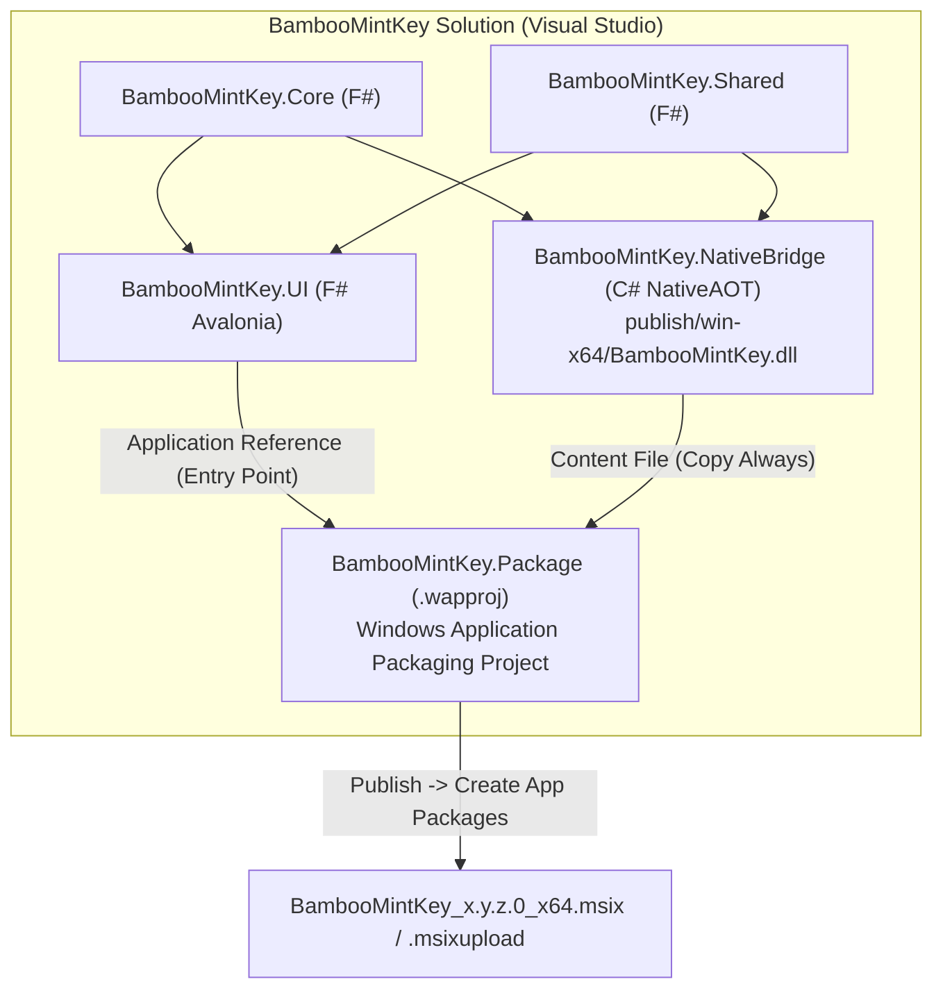

<!--
  BambooMintKey - Vietnamese Telex Input Method Editor for Windows
  Copyright (c) 2026 Dương Gia Long and LMO contributors
  SPDX-License-Identifier: MIT
-->

# Hướng Dẫn Thiết Kế & Đóng Gói MSIX Bằng Visual Studio (Phase 12)

**Mã tài liệu:** `012_01_MSIX_Packaging_Guide_VisualStudio`
**Đường dẫn:** `docs/2.Design/Phase12/012_01_MSIX_Packaging_Guide_VisualStudio.md`
**Giai đoạn:** Phase 12 — Đóng gói MSIX trên Windows qua Visual Studio
**Trạng thái:** 📘 Tài liệu Hướng dẫn Chuẩn (Guideline)
**Nền tảng mục tiêu:** Windows 10 (19041+) / Windows 11 (x64)

---

## 1. Tổng Quan & Lợi Ích Khi Dùng Visual Studio Đóng Gói MSIX

Thay vì phải chạy thủ công các công cụ dòng lệnh rời rạc của Windows SDK (`MakePri.exe`, `MakeAppx.exe`, `SignTool.exe`), việc sử dụng **Visual Studio (Windows Application Packaging Project — `.wapproj`)** mang lại các ưu điểm vượt trội:

1. **Giao diện trực quan (GUI Wizard):** Quản lý Manifest, tự động sinh trọn bộ kích thước Icon chuẩn Store (44x44, 150x150, 310x150, Store Logo) chỉ bằng 1 tấm ảnh gốc.
2. **Tự động gom phụ thuộc (Dependency Resolution):** Tự động đóng gói `BambooMintKey.UI` (Avalonia F#) cùng toàn bộ thư viện runtime đi kèm mà không sợ sót DLL.
3. **Liên kết trực tiếp Microsoft Partner Center:** Cho phép đăng nhập tài khoản Developer trên Visual Studio để đồng bộ tự động `Package Identity`, `Publisher ID` và xuất gói `.msixupload` chuẩn chỉnh để nộp lên Store.
4. **Tích hợp sẵn tạo chứng chỉ Sideloading & WACK:** Tạo chứng chỉ tự ký (Self-signed Certificate) bằng 1 cú click và chạy kiểm định **Windows App Certification Kit** ngay sau khi đóng gói.

---

## 2. Kiến Trúc Gói MSIX Cho Bộ Gõ TSF (`BambooMintKey`)



### Bảng thông số định danh chuẩn của BambooMintKey (Không được nhầm lẫn)

| Thành phần                              | Giá trị chuẩn trong mã nguồn        | Ghi chú                                                                                                         |
| :---------------------------------------- | :--------------------------------------- | :--------------------------------------------------------------------------------------------------------------- |
| **Executable chính (Entry Point)** | `BambooMintKey.UI.exe`                 | Ứng dụng cấu hình & Tray Icon                                                                                |
| **TSF In-Process COM DLL**          | `BambooMintKey.dll`                    | Biên dịch NativeAOT từ `BambooMintKey.NativeBridge`                                                         |
| **TSF Text Service CLSID**          | `B8A5A29D-68B1-4A59-B41E-D8B383D6F2C1` | Khai báo trong [`Guids.cs`](file:///D:/Kojin/BambooMintKey/src/BambooMintKey.NativeBridge/Common/Guids.cs#L18) |
| **TSF Language Profile GUID**       | `C2F31A8E-92D0-4F81-9C3E-A52889211D44` | Khai báo trong [`Guids.cs`](file:///D:/Kojin/BambooMintKey/src/BambooMintKey.NativeBridge/Common/Guids.cs#L21) |
| **Ngôn ngữ mục tiêu (LANGID)**  | `0x042A` (`vi-VN`)                   | Tiếng Việt                                                                                                     |

> [!WARNING]
> **Lưu ý quan trọng về CLSID:**
> Trong tài liệu nháp cũ ở Phase 4 từng ghi nhầm CLSID là `D8A27E4B-4E3F-4A92-805F-294FCE314D01` (đây thực chất là `AppId` của Inno Setup). Khi cấu hình `Package.appxmanifest`, bắt buộc phải dùng đúng CLSID thật của COM Server là **`B8A5A29D-68B1-4A59-B41E-D8B383D6F2C1`**.

---

## 3. Chuẩn Bị Môi Trường Trong Visual Studio

Trước khi bắt đầu, mở **Visual Studio Installer** $\rightarrow$ chọn **Modify** trên bản Visual Studio 2022 (hoặc 2026) và đảm bảo đã tích chọn:

1. **Workload: `.NET desktop development`** (bao gồm hỗ trợ ngôn ngữ **F# desktop support**).
2. **Workload: `WinUI application development`** (hoặc `Universal Windows Platform development`).
   - Trong cột **Installation details** bên phải, đảm bảo có tích:
     - `MSIX Packaging Tools`
     - `Windows 10 SDK (10.0.19041.0)` hoặc `Windows 11 SDK (10.0.22621.0 / 10.0.26100.0)`.

---

## 4. Hướng Dẫn Chi Tiết Từng Bước Tạo Project Đóng Gói MSIX

### Bước 1: Build sẵn `BambooMintKey.dll` (NativeAOT)

Vì `BambooMintKey.NativeBridge` được biên dịch bằng **NativeAOT** ra một DLL C gốc độc lập, hãy chạy lệnh publish trước để có file `publish\win-x64\BambooMintKey.dll`:

```powershell
dotnet publish src/BambooMintKey.NativeBridge/BambooMintKey.NativeBridge.csproj `
  -c Release -r win-x64 --self-contained `
  -o publish/win-x64 `
  -p:NativeLib=Shared -p:PublishAot=true
```

*(Ở Bước 4 bên dưới, chúng ta sẽ gắn lệnh này vào Pre-Build Event để Visual Studio tự động chạy mỗi khi đóng gói).*

---

### Bước 2: Thêm `Windows Application Packaging Project` vào Solution

1. Mở Visual Studio và mở solution `BambooMintKey.slnx` (hoặc tạo file `BambooMintKey.sln` nếu bản Visual Studio của bạn yêu cầu định dạng `.sln` truyền thống khi làm việc với `.wapproj`: chạy `dotnet new sln -n BambooMintKey` và add các project vào).
2. Trong cửa sổ **Solution Explorer**, nhấp chuột phải vào Solution $\rightarrow$ chọn **Add** $\rightarrow$ **New Project...**.
3. Tại ô tìm kiếm, gõ **`Packaging`** và chọn mẫu:
   - **Windows Application Packaging Project** (biểu tượng hộp gói hàng có logo Windows).
4. Đặt cấu hình:
   - **Project name:** `BambooMintKey.Package`
   - **Location:** `D:\Kojin\BambooMintKey\src` (hoặc `D:\Kojin\BambooMintKey\delivery\msix`)
5. Khi hộp thoại chọn phiên bản Windows hiện ra:
   - **Target version:** `Windows 11, version 22H2 (10.0; Build 22621)` (hoặc mới nhất trên máy).
   - **Minimum version:** `Windows 10, version 2004 (10.0; Build 19041)`.
   - Nhấn **OK**.

---

### Bước 3: Liên kết `BambooMintKey.UI` và nhúng `BambooMintKey.dll`

1. **Thêm Application Reference cho `BambooMintKey.UI`:**
   - Trong project `BambooMintKey.Package`, nhấp chuột phải vào mục **Applications** $\rightarrow$ chọn **Add Reference...**.
   - Tích chọn **`BambooMintKey.UI`** $\rightarrow$ nhấn **OK**.
   - Nhấp chuột phải vào `BambooMintKey.UI` vừa hiện ra dưới mục **Applications** $\rightarrow$ chọn **Set as Entry Point**.
2. **Đưa `BambooMintKey.dll` (NativeAOT TIP) vào gói MSIX:**
   - Nhấp chuột phải vào project `BambooMintKey.Package` $\rightarrow$ chọn **Add** $\rightarrow$ **Existing Item...**.
   - Duyệt tới thư mục `D:\Kojin\BambooMintKey\publish\win-x64\` $\rightarrow$ chọn bộ lọc **All Files (`*.*`)** $\rightarrow$ chọn **`BambooMintKey.dll`**.
   - **Mẹo quan trọng:** Thay vì bấm nút *Add* thông thường, hãy bấm mũi tên nhỏ cạnh nút Add và chọn **Add As Link** (để luôn trỏ trực tiếp tới file mới nhất trong `publish\win-x64\`).
   - Nhấp vào file `BambooMintKey.dll` trong `BambooMintKey.Package`, nhìn sang cửa sổ **Properties** (F4):
     - **Build Action:** `Content`
     - **Copy to Output Directory:** `Copy always`

---

### Bước 4: Tự động hóa Publish NativeAOT trong `.wapproj`

Để không phải chạy lệnh `dotnet publish` bằng tay trước mỗi lần bấm đóng gói trên Visual Studio:

1. Nhấp chuột phải vào project `BambooMintKey.Package` $\rightarrow$ chọn **Edit Project File** (`BambooMintKey.Package.wapproj`).
2. Thêm đoạn `<Target Name="PublishNativeBridgeAot" BeforeTargets="BeforeBuild">` vào cuối file (trước thẻ `</Project>`):

```xml
  <!-- Tự động publish NativeAOT BambooMintKey.dll trước khi đóng gói MSIX -->
  <Target Name="PublishNativeBridgeAot" BeforeTargets="BeforeBuild">
    <Exec Command="dotnet publish "$(SolutionDir)src\BambooMintKey.NativeBridge\BambooMintKey.NativeBridge.csproj" -c Release -r win-x64 --self-contained -o "$(SolutionDir)publish\win-x64" -p:NativeLib=Shared -p:PublishAot=true"
           Condition="!Exists('$(SolutionDir)publish\win-x64\BambooMintKey.dll')" />
  </Target>
```

---

### Bước 5: Tạo Bộ Icon Chuẩn Microsoft Store Bằng Visual Studio Asset Generator

1. Trong project `BambooMintKey.Package`, nhấp đúp vào file **`Package.appxmanifest`** để mở giao diện thiết kế trực quan.
2. Chuyển sang tab **Visual Assets**.
3. Tại mục **Source** (trong phần *All Visual Assets*):
   - Nhấn nút **`...`** và chọn file ảnh gốc độ phân giải cao: `D:\Kojin\BambooMintKey\src\media\bamboomintkey.png` (hoặc ảnh PNG vuông $1024 \times 1024$).
4. Trong mục **GenerateAssets**, nhấn nút **Generate**.
   - Visual Studio sẽ tự động cắt, co giãn và tạo đầy đủ hơn 30 file ảnh đúng chuẩn kích thước của Microsoft Store vào thư mục `Images\` và cập nhật tự động vào Manifest.

---

### Bước 6: Cấu hình `Package.appxmanifest` (Full Trust + COM Server + Tắt Registry Virtualization)

Đây là **bước kỹ thuật quan trọng nhất** đối với một bộ gõ TSF.

#### 6.1. Tại sao cần cấu hình đặc biệt cho TSF trong MSIX?

Mặc định, ứng dụng MSIX bị áp đặt cơ chế **Registry Write Virtualization** (mọi thao tác ghi vào `HKLM` / `HKCU` bị chuyển hướng vào file `Registry.dat` ảo, khiến Windows TSF `ctfmon.exe` không nhìn thấy bộ gõ). Do đó, ta cần:

1. Tắt `RegistryWriteVirtualization` qua namespace `desktop6` và capability `unvirtualizedResources`.
2. Khai báo `windows.comServer` cho `BambooMintKey.dll` với CLSID `B8A5A29D-68B1-4A59-B41E-D8B383D6F2C1`.
3. Khai báo `windows.startupTask` để `BambooMintKey.UI.exe --tray` tự khởi chạy cùng Windows.

#### 6.2. Nội dung XML chuẩn của `Package.appxmanifest`

Nhấp chuột phải vào `Package.appxmanifest` $\rightarrow$ chọn **View Code** (F7) và cấu hình như sau:

```xml
<?xml version="1.0" encoding="utf-8"?>
<Package
  xmlns="http://schemas.microsoft.com/appx/manifest/foundation/windows10"
  xmlns:uap="http://schemas.microsoft.com/appx/manifest/uap/windows10"
  xmlns:rescap="http://schemas.microsoft.com/appx/manifest/foundation/windows10/restrictedcapabilities"
  xmlns:desktop="http://schemas.microsoft.com/appx/manifest/desktop/windows10"
  xmlns:desktop6="http://schemas.microsoft.com/appx/manifest/desktop/windows10/6"
  xmlns:com="http://schemas.microsoft.com/appx/manifest/com/windows10"
  IgnorableNamespaces="uap rescap desktop desktop6 com">

  <!-- Khi liên kết với Partner Center (Bước 8), Visual Studio sẽ tự điền Name và Publisher chuẩn -->
  <Identity
    Name="BambooMintKey"
    Publisher="CN=LMO-LAB"
    Version="1.2.0.0"
    ProcessorArchitecture="x64" />

  <Properties>
    <DisplayName>BambooMintKey</DisplayName>
    <PublisherDisplayName>Dương Gia Long (LMO-LAB)</PublisherDisplayName>
    <Logo>Images\StoreLogo.png</Logo>
    <!-- Tắt ảo hóa Registry và FileSystem để bộ gõ đồng bộ trực tiếp với hệ thống -->
    <desktop6:RegistryWriteVirtualization>disabled</desktop6:RegistryWriteVirtualization>
    <desktop6:FileSystemWriteVirtualization>disabled</desktop6:FileSystemWriteVirtualization>
  </Properties>

  <Dependencies>
    <TargetDeviceFamily Name="Windows.Desktop" MinVersion="10.0.19041.0" MaxVersionTested="10.0.22621.0" />
  </Dependencies>

  <Resources>
    <Resource Language="vi-VN" />
    <Resource Language="en-US" />
  </Resources>

  <Applications>
    <Application Id="App"
      Executable="$targetnametoken$.exe"
      EntryPoint="Windows.FullTrustApplication">
      <uap:VisualElements
        DisplayName="BambooMintKey"
        Description="Bộ gõ tiếng Việt Telex hiệu năng cao (F# & NativeAOT)"
        BackgroundColor="transparent"
        Square150x150Logo="Images\Square150x150Logo.png"
        Square44x44Logo="Images\Square44x44Logo.png">
        <uap:DefaultTile Wide310x150Logo="Images\Wide310x150Logo.png" />
      </uap:VisualElements>

      <Extensions>
        <!-- 1. Tự khởi động ở chế độ khay hệ thống (Tray Icon) khi đăng nhập Windows -->
        <desktop:Extension Category="windows.startupTask"
                           Executable="$targetnametoken$.exe"
                           EntryPoint="Windows.FullTrustApplication">
          <desktop:StartupTask TaskId="BambooMintKeyTrayStartup"
                               Enabled="true"
                               DisplayName="BambooMintKey Vietnamese Input" />
        </desktop:Extension>

        <!-- 2. Khai báo In-Process COM Server cho BambooMintKey.dll -->
        <com:Extension Category="windows.comServer">
          <com:ComServer>
            <com:InProcessServer>
              <com:Path>BambooMintKey.dll</com:Path>
              <com:Class Id="b8a5a29d-68b1-4a59-b41e-d8b383d6f2c1"
                         ThreadingModel="Both" />
            </com:InProcessServer>
          </com:ComServer>
        </com:Extension>
      </Extensions>
    </Application>
  </Applications>

  <Capabilities>
    <rescap:Capability Name="runFullTrust" />
    <rescap:Capability Name="unvirtualizedResources" />
  </Capabilities>
</Package>
```

---

## 5. Xử Lý Đăng Ký TSF Profile Khi Cài Đặt Qua MSIX (First-Run Provisioning)

> [!IMPORTANT]
> **Điểm khác biệt cốt lõi giữa MSIX và Inno Setup (`.exe`):**
>
> - Inno Setup chạy dưới quyền Admin và chủ động gọi `regsvr32.exe /s BambooMintKey.dll` trong lúc cài đặt để đăng ký TSF Language Profile (`ITfInputProcessorProfileMgr::RegisterProfile`) và TSF Categories (`ITfCategoryMgr::RegisterCategory`).
> - Gói **MSIX** khi cài đặt qua Windows App Installer **không tự động gọi hàm `DllRegisterServer`** bên trong `BambooMintKey.dll`. Nếu chỉ khai báo `<com:ComServer>` trong `Package.appxmanifest`, Windows chỉ biết COM CLSID nhưng **TSF Language Bar chưa biết sự tồn tại của bộ gõ tiếng Việt (`0x042A`)**.

### Phương án giải quyết chuẩn trong `BambooMintKey.UI`:

Để gói MSIX hoạt động trọn vẹn 100% ngay sau khi mở ứng dụng lần đầu:

1. Khi `BambooMintKey.UI.exe` khởi chạy, kiểm tra khóa Registry:
   `HKLM\SOFTWARE\Microsoft\CTF\TIP\{B8A5A29D-68B1-4A59-B41E-D8B383D6F2C1}\LanguageProfile\0x0000042a\{C2F31A8E-92D0-4F81-9C3E-A52889211D44}`
2. Nếu chưa tồn tại (hoặc đường dẫn DLL thay đổi khi nâng cấp phiên bản MSIX):
   - Copy `BambooMintKey.dll` từ thư mục gói MSIX (`AppContext.BaseDirectory`) ra thư mục cố định `C:\ProgramData\BambooMintKey\BambooMintKey.dll` (nơi cả tiến trình Win32 lẫn AppContainer đều có quyền `ReadAndExecute` ổn định xuyên suốt các bản cập nhật MSIX).
   - Kích hoạt `regsvr32.exe /s "C:\ProgramData\BambooMintKey\BambooMintKey.dll"` (yêu cầu UAC 1 lần duy nhất ở lần chạy đầu tiên) và ghi kích hoạt HKCU Profile tương tự `scripts/windows/enable-tip.ps1`.
   - Khởi động lại `ctfmon.exe`.

---

## 6. Quy Trình Xuất Gói `.msix` / `.msixupload` Trên Visual Studio

Sau khi cấu hình xong, chuyển cấu hình Build trên thanh công cụ Visual Studio sang **`Release`** và kiến trúc **`x64`** (không chọn `Any CPU`).

### 6.1. Trường hợp A: Xuất gói `.msix` để cài đặt nội bộ (Sideloading / GitHub Releases)

1. Nhấp chuột phải vào project **`BambooMintKey.Package`** $\rightarrow$ chọn **Publish** $\rightarrow$ **Create App Packages...**.
2. Chọn **Sideloading** $\rightarrow$ nhấn **Next**.
3. Tại màn hình **Select and configure packages**:
   - Chọn **Yes, select a certificate**.
   - Nếu chưa có chứng chỉ, nhấn nút **Create...**:
     - Điền `Publisher Common Name`: `LMO-LAB` (khớp với `CN=LMO-LAB` trong Manifest).
     - Nhập mật khẩu bảo vệ file `.pfx` (hoặc để trống nếu chỉ test local) $\rightarrow$ nhấn **OK**.
   - Nhấn nút **Trust** để Visual Studio tự động cài đặt chứng chỉ này vào kho `Trusted People` / `Trusted Root Certification Authorities` trên máy bạn.
4. Tại màn hình **Select and configure packages**:
   - **Output location:** `D:\Kojin\BambooMintKey\delivery\msix\`
   - **Generate app bundle:** Chọn **`Never`** (nếu bạn chỉ xuất duy nhất bản `x64` để thu được file `.msix` đơn lẻ gọn nhẹ) hoặc **`Always`** (nếu muốn xuất `.msixbundle`).
   - Trong bảng Architecture, chỉ tích chọn **`x64` (`Release`)**.
5. Nhấn **Create**.
6. Sau khoảng 15–30 giây, Visual Studio sẽ báo **Package Creation Completed** và xuất ra:
   - `BambooMintKey_1.2.0.0_x64.msix`
   - `BambooMintKey_1.2.0.0_x64.cer` (Chứng chỉ đi kèm)
   - `Install.ps1` (Script cài đặt tự động)

---

### 6.2. Trường hợp B: Xuất gói `.msixupload` để đưa thẳng lên Microsoft Store

1. Nhấp chuột phải vào **`BambooMintKey.Package`** $\rightarrow$ chọn **Publish** $\rightarrow$ **Associate App with the Store...**.
2. Đăng nhập bằng tài khoản **Microsoft Partner Center** của bạn.
3. Chọn tên ứng dụng **BambooMintKey** đã đặt chỗ trên Store $\rightarrow$ nhấn **Associate**.
   - *Visual Studio sẽ tự động cập nhật `Package/Identity/Name`, `Package/Identity/Publisher` và `PublisherDisplayName` trong `Package.appxmanifest` khớp 100% với Store!*
4. Tiếp tục nhấp chuột phải vào **`BambooMintKey.Package`** $\rightarrow$ **Publish** $\rightarrow$ **Create App Packages...**.
5. Chọn **Microsoft Store under a existing app name** $\rightarrow$ nhấn **Next**.
6. Tích chọn kiến trúc **`x64` (`Release`)** $\rightarrow$ nhấn **Create**.
7. Kết quả thu được file **`BambooMintKey_1.2.0.0_x64.msixupload`** tại thư mục output.
8. Nhấn nút **Launch Windows App Certification Kit** ở màn hình kết thúc để chạy kiểm định tự động trước khi kéo thả file `.msixupload` lên trang **Partner Center -> Packages**.

---

## 7. Kiểm Thử Cài Đặt & Gỡ Cài Đặt Gói MSIX Trên Máy Local

### 7.1. Cài đặt thử nghiệm

Bạn có thể nhấp đúp trực tiếp vào file `BambooMintKey_1.2.0.0_x64.msix` để mở giao diện **Windows App Installer** và bấm **Install**, hoặc dùng PowerShell:

```powershell
# Cài đặt gói MSIX
Add-AppxPackage -Path "D:\Kojin\BambooMintKey\delivery\msix\BambooMintKey_1.2.0.0_x64\BambooMintKey_1.2.0.0_x64.msix"
```

### 7.2. Kiểm tra thông tin gói đã cài

```powershell
Get-AppxPackage -Name "*BambooMintKey*"
```

### 7.3. Gỡ cài đặt sạch khi kiểm thử

```powershell
# 1. Hủy đăng ký TSF TIP trước khi gỡ gói MSIX (nếu đã đăng ký thủ công)
pwsh -File scripts/windows/unregister-tip.ps1

# 2. Gỡ gói MSIX khỏi hệ thống
Get-AppxPackage -Name "*BambooMintKey*" | Remove-AppxPackage
```

---

## 8. Checklist Kiểm Tra Trước Khi Phát Hành (Release Checklist)

- [ ] Đã cập nhật số phiên bản đồng bộ tại `Directory.Build.props` và `Package.appxmanifest` (Định dạng 4 số của MSIX: `Major.Minor.Patch.0`, ví dụ `1.2.0.0`).
- [ ] Đã build lại `publish\win-x64\BambooMintKey.dll` ở chế độ `Release` NativeAOT mới nhất.
- [ ] Trong `Package.appxmanifest`, `Class Id` của `com:InProcessServer` khớp chính xác với `B8A5A29D-68B1-4A59-B41E-D8B383D6F2C1`.
- [ ] Khi chọn cấu hình đóng gói trên Visual Studio, chọn đúng **`Release | x64`** (không dùng `Debug`).
- [ ] Chạy **Windows App Certification Kit (WACK)** đạt kết quả **PASSED**.
