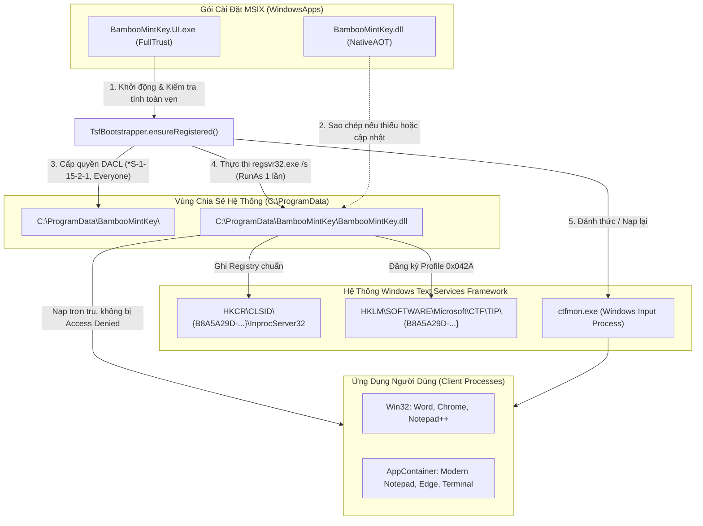

<!--
  BambooMintKey - Vietnamese Telex Input Method Editor for Windows
  Copyright (c) 2026 Dương Gia Long and LMO contributors
  SPDX-License-Identifier: MIT
-->

# Kiến Trúc TSF Bootstrapper & Khắc Phục Toàn Diện Đóng Gói MSIX (Phase 12)

**Mã tài liệu:** `012_02_MSIX_TSF_Bootstrapper_Architecture_and_Troubleshooting`  
**Đường dẫn:** `docs/2.Design/Phase12/012_02_MSIX_TSF_Bootstrapper_Architecture_and_Troubleshooting.md`  
**Giai đoạn:** Phase 12 — Đóng gói MSIX & Tích hợp TSF Runtime trên Windows  
**Trạng thái:** 📘 Tài liệu Kiến trúc & Khắc phục Sự cố Chuẩn (Engineering Architecture & Troubleshooting Guide)  
**Nền tảng mục tiêu:** Windows 10 (19041+) / Windows 11 (x64) — Visual Studio 2026 (v18) / .NET 10  

---

## 1. Bối Cảnh & Vấn Đề Kỹ Thuật Khi Đưa TSF TIP Vào Gói MSIX

Khi phát hành bộ gõ qua **Microsoft Store** hoặc gói **MSIX**, kiến trúc sandbox của Windows Desktop Bridge đặt ra hai thách thức kỹ thuật cốt lõi đối với bộ gõ bàn phím chuẩn Windows Text Services Framework (TSF):

### 1.1. Ranh giới bảo mật WindowsApps (`ERROR_ACCESS_DENIED = 5`)
- Khi cài đặt qua MSIX, toàn bộ file nhị phân của ứng dụng được lưu tại thư mục hệ thống:  
  `C:\Program Files\WindowsApps\<PackageIdentityName>_\...`
- Thư mục này được bảo vệ bởi danh sách kiểm soát truy cập (DACL) nghiêm ngặt của Windows.
- Khi người dùng gõ phím trong ứng dụng bên ngoài (Notepad, Microsoft Word, Google Chrome, Game...), tiến trình quản lý bàn phím của Windows (`ctfmon.exe`) hoặc chính tiến trình ứng dụng đó sẽ gọi `LoadLibrary` nạp COM DLL của bộ gõ (`BambooMintKey.dll`).
- Do các tiến trình thông thường không thuộc gói ứng dụng, việc nạp DLL từ thư mục `WindowsApps` lập tức bị Windows từ chối với lỗi **`Access is denied (0x80070005 / ERROR_ACCESS_DENIED = 5)`**.

### 1.2. Hạn chế của MSIX đối với `regsvr32` & COM Server Registration
- Khác với trình cài đặt cổ điển (Inno Setup / MSI), bộ cài MSIX **không chạy script tùy biến** và không tự động gọi `regsvr32.exe` khi cài đặt.
- Nếu chỉ khai báo `<com:ComServer>` trong `Package.appxmanifest`, Windows chỉ nhận biết CLSID COM trong phạm vi gói chứ **Text Services Framework chưa hề biết sự tồn tại của Profile tiếng Việt (`0x042A`)**.
- **Hệ quả:** Ứng dụng cài đặt thành công nhưng **hoàn toàn không xuất hiện** trong Language Bar hoặc danh sách bàn phím hệ thống của Windows Settings.

### 1.3. Lỗi treo ứng dụng (UI Hang / Event 1002) & Ẩn Taskbar Tray
Khi cài đặt thử nghiệm phiên bản MSIX ban đầu, xuất hiện các hiện tượng:
1. **Lỗi `hInstance` Win32:** Trong `TrayIconManager.fs`, biến `wc.hInstance` nhận giá trị từ `Process.GetCurrentProcess().Handle` (là Process Kernel Handle) thay vì `GetModuleHandleW(null)` (HMODULE / Instance Handle). Điều này khiến `RegisterClassExW` thất bại, Message Window không nhận được sự kiện chuột từ khay hệ thống.
2. **Ẩn nhầm Tray Icon:** Logic `isBambooMintKeyActive()` tự động ẩn Tray Icon khi cửa sổ hiện tại không gõ tiếng Việt. Khi bộ gõ chưa kích hoạt, icon bị ẩn hoàn toàn; kết hợp với việc đóng cửa sổ chính chỉ gọi `Hide()`, ứng dụng rơi vào trạng thái "vô hình" (không có cửa sổ, không có Tray Icon, không thể tương tác).
3. **Veto Shutdown:** Sự kiện `Closing` chặn thoát (`e.Cancel <- true`) khi chưa cấp cờ `allowClose`, khiến Windows ghi nhận sự kiện lỗi `Event 1002 Application Hang`.

---

## 2. Giải Pháp Toàn Diện: Kiến Trúc Hướng A (Self-Deploying Bootstrapper)

Để vừa tận dụng khả năng **tự động cập nhật qua Microsoft Store**, vừa đảm bảo **TSF hoạt động trơn tru trên mọi ứng dụng**, kiến trúc **Self-Deploying Bootstrapper** đã được thiết kế và triển khai:



### Chi tiết các bước thực hiện của [`TsfBootstrapper.fs`](file:///d:/Kojin/BambooMintKey/src/BambooMintKey.UI/TsfBootstrapper.fs):

1. **Phát hiện DLL nguồn:** Tự động tìm `BambooMintKey.dll` trong thư mục triển khai của gói MSIX (`AppContext.BaseDirectory` hoặc các thư mục liên đới).
2. **Kiểm tra trạng thái đăng ký (`isAlreadyRegistered`):**
   - So sánh kích thước file (`Length`) giữa DLL nguồn và file tại `C:\ProgramData\BambooMintKey\BambooMintKey.dll`.
   - Kiểm tra khóa COM `HKCR\CLSID\{B8A5A29D-68B1-4A59-B41E-D8B383D6F2C1}\InprocServer32` có trỏ chính xác về đường dẫn `ProgramData` hay không.
   - Kiểm tra khóa TSF Profile tiếng Việt tại `HKLM\SOFTWARE\Microsoft\CTF\TIP\{B8A5A29D-...}\LanguageProfile\0x0000042a\{C2F31A8E-...}`.
   - **Nếu tất cả hợp lệ:** Bỏ qua toàn bộ chu trình, ứng dụng khởi động tức thì trong **0ms** và không hiển thị bất kỳ hộp thoại nào.
3. **Cấp quyền đa môi trường sandbox (`grantDirectoryPermissions`):**
   - Sử dụng `icacls` cấp quyền `(OI)(CI)RX` (Đọc & Thực thi) cho hai định danh bảo mật cốt lõi:
     - `*S-1-15-2-1` (`ALL APPLICATION PACKAGES`): Bắt buộc để các ứng dụng chạy trong AppContainer sandbox của Windows 10/11 (như Microsoft Edge, Modern Notepad, Windows Terminal) có quyền nạp DLL.
     - `*S-1-1-0` (`Everyone`): Đảm bảo các tiến trình chạy dưới mọi user account đều truy cập được.
4. **Đăng ký hệ thống (`registerWithRegsvr32`):**
   - Chạy lệnh `regsvr32.exe /s "C:\ProgramData\BambooMintKey\BambooMintKey.dll"` với động từ `Verb = "runas"` (UAC elevation) để hoàn tất ghi vào `HKLM` và gọi `ITfInputProcessorProfiles`.
5. **Đánh thức TSF (`notifyCtfmon`):**
   - Gọi `ctfmon.exe` để hệ thống làm mới danh sách bộ gõ và hiển thị icon ngay trên Taskbar Language Indicator.

---

## 3. Hoàn Thiện Vòng Đời Ứng Dụng & Tray Icon Trên Windows

Nhằm mang lại trải nghiệm quen thuộc, tin cậy và không bao giờ bị treo, các thành phần giao diện đã được tái thiết kế:

### 3.1. Tray Icon luôn luôn thường trực ([`TrayIconManager.fs`](file:///d:/Kojin/BambooMintKey/src/BambooMintKey.UI/TrayIconManager.fs))
- **Không tự ẩn:** Khác với macOS nơi InputMethodKit quản lý menu bàn phím, trên Windows, ứng dụng gõ tiếng Việt (như UniKey/EVKey) phải luôn duy trì icon trên Notification Area để làm điểm neo điều khiển.
- **Tương tác chuột:**
  - **Click chuột trái:** Đảo nhanh chế độ giữa **[ V ]** (Tiếng Việt) và **[ E ]** (Tiếng Anh). Icon và Tooltip cập nhật thời gian thực.
  - **Nhấp đúp chuột trái (`WM_LBUTTONDBLCLK`):** Mở Bảng điều khiển & Cài đặt (`MainWindow`).
  - **Click chuột phải:** Mở Context Menu chuẩn Win32 (hỗ trợ chuyển kiểu gõ Telex/VNI/Simple, bảng mã Unicode/TCVN3, kiểu bỏ dấu, và nút **"Thoát BambooMintKey"**).
- **Phục hồi sự cố Explorer:** Bắt thông điệp Win32 `TaskbarCreated`, tự động đăng ký lại icon khi thanh Taskbar của Windows khởi động lại.

### 3.2. Cơ chế Single-Instance với Event đồng bộ ([`App.axaml.fs`](file:///d:/Kojin/BambooMintKey/src/BambooMintKey.UI/App.axaml.fs))
- Sử dụng Named Mutex `Local\BambooMintKey_UI_Process_Mutex_v1` để nhận biết tiến trình đang chạy.
- **Nếu đã có một bản đang chạy:** Tiến trình mới kích hoạt Event `Local\BambooMintKey_ShowMainWindow_Event_v1` rồi tự thoát êm đẹp với mã 0 (`desktop.Shutdown(0)`).
- **Tiến trình đang chạy:** Thread lắng nghe sẽ nhận được tín hiệu và gọi `mainWindow.BringToFront()` (khôi phục trạng thái cửa sổ từ minimized/hidden lên tiền cảnh và nhận focus).

### 3.3. Bảo vệ tắt máy & đóng cửa sổ ([`MainWindow.axaml.fs`](file:///d:/Kojin/BambooMintKey/src/BambooMintKey.UI/MainWindow.axaml.fs))
- Đăng ký sự kiện `AppDomain.CurrentDomain.ProcessExit`: Tự động đặt cờ `allowClose <- true` khi hệ thống yêu cầu tắt ứng dụng, ngăn chặn hoàn toàn việc veto shutdown gây lỗi Event 1002.
- Hàm `ForceClose()` cho phép thoát dứt điểm khi người dùng chọn "Thoát" từ menu khay hệ thống.

---

## 4. Cấu Hình Build & Đóng Gói Với Visual Studio 2026 (v18)

### 4.1. Cấu hình SDK Cố Định (`global.json`)
Visual Studio 2026 sử dụng MSBuild phiên bản 18 (`18.10.1`). File [`global.json`](file:///d:/Kojin/BambooMintKey/global.json) tại thư mục gốc bảo đảm toàn bộ hệ sinh thái SDK hoạt động đồng nhất:

```json
{
  "sdk": {
    "version": "10.0.403",
    "rollForward": "latestFeature"
  }
}
```

### 4.2. Xử lý các lỗi Manifest & Tài nguyên đồ họa
1. **Giới hạn kích thước ảnh 204,800 bytes:**
   - File `LargeTile.scale-400.png` (239 KB) vượt ngưỡng 200 KB của Windows AppX Packaging Engine.
   - Giải pháp: Sử dụng `scale-200.png` (70 KB) và base `LargeTile.png` làm nguồn chuẩn, Windows App Installer sẽ tự nội suy độ nét cao mà không bị chặn đóng gói.
2. **Khai báo `windows.startupTask` trong `Package.appxmanifest`:**
   - Bỏ các thuộc tính dư thừa `Executable="$targetnametoken$.exe"` và `EntryPoint="$targetentrypoint$"` bên trong thẻ `<desktop:StartupTask>`, cho phép task kế thừa trực tiếp từ `<Application>`.

### 4.3. Lệnh đóng gói tự động qua CLI (MSBuild 18)
Có thể thực thi lệnh sau từ PowerShell để đóng gói bản phát hành:

```powershell
& "C:\Program Files\Microsoft Visual Studio\18\Community\MSBuild\Current\Bin\MSBuild.exe" `
    BambooMintKey.Package/BambooMintKey.Package.wapproj `
    /p:Configuration=Release `
    /p:Platform=x64 `
    /nologo /v:m
```

File đóng gói thành phẩm được tạo tại:  
`BambooMintKey.Package\AppPackages\BambooMintKey.Package_1.2.1.0_Test\BambooMintKey.Package_1.2.1.0_x64.msixbundle`

---

## 5. Tính Độc Lập Đa Nền Tảng (Cross-Platform Isolation)

Tất cả các cơ chế liên quan đến Windows (TSF, COM InprocServer, `icacls`, Registry, MSIX wapproj) đều được cô lập tuyệt đối trong các project dành riêng cho Windows:

| Dự án | Nền tảng | Thành phần phụ thuộc | Tác động từ Phase 12 |
| :--- | :--- | :--- | :--- |
| `BambooMintKey.Core` | Chung (Pure F#) | Không phụ thuộc OS | Nhận bản sửa lỗi xử lý vần tiếng Việt (`duong` $\rightarrow$ `duông`), 530/530 test cases passed. |
| `BambooMintKey.Shared` | Chung (Pure F#) | Shared structs & hotkey | Không đổi. |
| `BambooMintKey.UI` | Windows (Avalonia) | Win32 API, TSF Bootstrapper | Triển khai giải pháp MSIX Bootstrapper & Tray Icon mới. |
| `BambooMintKey.UI.Linux` | Linux (Avalonia) | D-Bus client, SingleInstance Linux | **Hoàn toàn độc lập** — Build Succeeded (0 Error, 0 Warning). |
| `BambooMintKey.UI.Mac` | macOS (Avalonia) | InputMethodKit, SingleInstance Mac | **Hoàn toàn độc lập** — Build Succeeded (0 Error, 0 Warning). |

---

## 6. Tổng Kết

Giải pháp **Self-Deploying Bootstrapper (Hướng A)** đã tháo gỡ hoàn toàn bài toán phân phối bộ gõ TSF trên Windows thông qua định dạng hiện đại MSIX:
1. **Tuân thủ Store:** Đóng gói nguyên bản MSIX, sẵn sàng phân phối và tự động cập nhật qua Microsoft Store.
2. **Khắc phục Sandbox:** Tự động triển khai COM DLL ra `C:\ProgramData\BambooMintKey` với DACL mở rộng cho toàn bộ tiến trình và AppContainer UWP.
3. **Trải nghiệm mượt mà:** Khởi động 0ms khi đã nạp, Tray Icon thường trực, điều khiển trực quan, hoàn toàn tương thích và không ảnh hưởng tới các phiên bản macOS và Linux.

