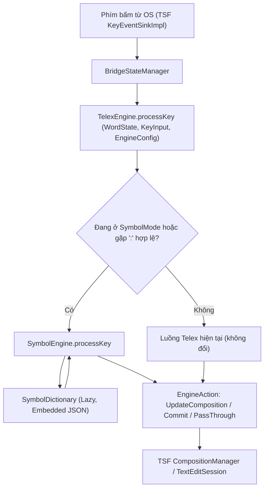

<!--
  BambooMintKey - Vietnamese Telex Input Method Editor
  Copyright (c) 2026 Dương Gia Long and LMO contributors
  SPDX-License-Identifier: MIT
-->

# 013_01 — Thiết Kế Sample: Gõ Ký Hiệu & Icon Có Inline Preview (`::mui →`)

**Mã tài liệu:** `013_01_Symbol_Shortcode_Sample_Design`

**Giai đoạn:** Phase 13 — Gõ ký hiệu, icon, emoji (Bước Sample / PoC)

**Thuộc module:** `src/BambooMintKey.Core`, `dicts/`, `src/BambooMintKey.NativeBridge`, `tests/BambooMintKey.Core.Tests`

**Tài liệu liên quan:** [013_00_Symbol_Shortcode_Idea.md](./013_00_Symbol_Shortcode_Idea.md)

**Trạng thái:** 📝 Bản thiết kế hoàn chỉnh cho Sample — Chờ duyệt trước khi triển khai code.

---

## 1. Mục Tiêu Và Phạm Vi Sample

Thay vì dàn trải ngay sang popup đa nền tảng, từ điển CLDR lớn và Settings GUI, bản Sample là **một lát cắt dọc hoàn chỉnh (vertical slice)** gồm:

1. Lõi `SymbolDictionary` + `SymbolEngine` thuần F# trong `BambooMintKey.Core` (có **inline preview** ngay trong composition).
2. Tích hợp vào **Windows TSF (`BambooMintKey.NativeBridge`)** để dùng thử thực tế hằng ngày.
3. Bộ Unit Test đầy đủ cho mọi nhánh trạng thái trong `BambooMintKey.Core.Tests`.

### 1.1. Ba rủi ro cần kiểm chứng bằng Sample

| # | Rủi ro (từ `013_00` mục 8) | Cách Sample kiểm chứng |
|---|---|---|
| **R1** | Giữ dấu `:` đầu từ ở trạng thái chờ (`PendingColon`) có gây khó chịu hoặc lỗi khi gõ bình thường (`Lưu ý:`, `10:30`, `std::vector`)? | Dùng thử thực tế trên Notepad, Word, Browser, VS Code, Terminal ở cả 2 chế độ `enablePreedit = false` và `true`. |
| **R2** | Ký tự Unicode đa code point (`⚠️` có VS16, cờ `🇻🇳`, emoji surrogate pair `✅🔥`) chốt qua TSF `SetText` có bị vỡ/mất ký tự không? | Đưa đủ nhóm ký tự đại diện vào từ điển mẫu ~15 mục và kiểm thử trên các ứng dụng đích. |
| **R3** | Cơ chế **Inline Preview** (`::mui → (1/7)`) + `Tab` xoay vòng có đủ rõ ràng và mượt trước khi đầu tư popup TSF hay không? | Tự dogfood luồng gõ hằng ngày (Markdown, chat, ghi chú). |

### 1.2. Phân định Trong phạm vi vs. Ngoài phạm vi Sample

| Trong phạm vi Sample (Làm ngay) | Ngoài phạm vi Sample (Để bước sau) |
|---|---|
| Từ điển mẫu ~15 từ khóa trong `dicts/symbols-vi.json` (nhúng `EmbeddedResource`, nạp lười, NativeAOT-safe) | Script import Unicode CLDR `vi` & cập nhật `THIRD-PARTY-NOTICES.md` |
| Trigger cố định `::` ở đầu từ | Cho phép đổi chuỗi kích hoạt (`;;`, `\`), phím tắt `Ctrl + .`, `ExcludedProcesses` |
| **Inline Preview** ngay trong composition (`::mui → (1/7)`), xoay vòng bằng `Tab` / `Shift+Tab` | Cửa sổ popup / Candidate list (TSF Popup, Fcitx5 `CommonCandidateList`, macOS `IMKCandidates`) và chọn nhanh `1–9` |
| Chốt bằng `Space` / `Enter`, hủy an toàn bằng `Esc`, thoát nguyên văn khi không khớp (`::before`) | `Backspace` undo sau khi đã chốt; di chuyển con trỏ vào giữa cặp ngoặc (`「|」`) |
| Tích hợp hoàn chỉnh trên Windows TSF (`BambooMintKey.NativeBridge`) | Tích hợp C-ABI / Fcitx5 / macOS IMK, tab "Ký hiệu" trong Settings GUI, từ điển người dùng, danh sách "gần đây" |

---

## 2. Kiến Trúc Tổng Thể Và Luồng Dữ Liệu

Toàn bộ logic nhận diện `::`, chuẩn hóa từ khóa, lọc tiền tố, xoay ứng viên và dựng chuỗi Inline Preview nằm **100% trong `BambooMintKey.Core` (F# thuần)**. Lớp nền tảng (`NativeBridge`) chỉ làm nhiệm vụ chuyển phím và hiển thị chuỗi composition/commit.



### Nguyên tắc không phá vỡ (Non-Breaking Integration)

- Giữ nguyên chữ ký công khai của `TelexEngine.processKey : WordState -> KeyInput -> EngineConfig -> WordState * EngineAction`.
- Không thay đổi hành vi Telex hiện có khi người dùng không gõ `::` ở đầu từ.
- Khi `EnableSymbolShortcode = false`, toàn bộ nhánh `SymbolEngine` bị bỏ qua với chi phí 1 phép kiểm tra boolean (`O(1)`).

---

## 3. Thiết Kế Trải Nghiệm Inline Preview

### 3.1. Định dạng chuỗi Composition khi đang gõ

Thay vì thay thế ngay `::mui` bằng `→` (làm người dùng không thấy mình đang gõ dở từ khóa gì), composition hiển thị **từ khóa gốc + ký tự xem trước**:

| Số lượng ứng viên khớp | Định dạng Composition | Ví dụ khi gõ `::mui` / `::lua` / `::before` |
|---|---|---|
| `0` (không khớp) | `::<query>` | `::before` |
| `1` (duy nhất) | `::<query> <symbol>` | `::lua 🔥` |
| `> 1` (nhiều ứng viên) | `::<query> <symbol> (<idx>/<total>)` | `::mui → (1/7)` |

> **Lý do chọn định dạng này:**
> - Người dùng luôn thấy rõ mình đang gõ từ khóa nào (đặc biệt hữu ích khi gõ tiền tố `::m` → `::m → (1/9)` hoặc gõ nhầm chính tả `::muo` → `::muo` biến mất preview ngay để biết sai).
> - Chỉ số `(1/7)` báo hiệu rõ có nhiều hơn 1 ứng viên để bấm `Tab` xoay vòng.
> - Khi **chốt (`Space` / `Enter`)**, engine **chỉ commit đúng `<symbol>`** (ví dụ `"→"`), xóa sạch phần `::mui` và `(1/7)`.

### 3.2. Minh họa luồng thao tác từng phím

#### Tình huống 1: Gõ `::mui`, xoay chọn `↑`, chốt bằng `Space`

| Phím bấm | Trạng thái nội bộ | Composition hiển thị | Hành động OS |
|---|---|---|---|
| `:` | `PendingColon` | `:` | `UpdateComposition ":"` |
| `:` | `TriggerReady` | `::` | `UpdateComposition "::"` |
| `m` | `Collecting("m", idx=0)` | `::m → (1/9)` | `UpdateComposition` |
| `u` | `Collecting("mu", idx=0)` | `::mu → (1/7)` | `UpdateComposition` |
| `i` | `Collecting("mui", idx=0)` | `::mui → (1/7)` | `UpdateComposition` |
| `Tab` | `Collecting("mui", idx=1)` | `::mui ← (2/7)` | `UpdateComposition` |
| `Tab` | `Collecting("mui", idx=2)` | `::mui ↑ (3/7)` | `UpdateComposition` |
| `Shift+Tab` | `Collecting("mui", idx=1)` | `::mui ← (2/7)` | `UpdateComposition` |
| `Space` hoặc `Enter` | `Idle` | *(kết thúc)* | `Commit "←"` |

#### Tình huống 2: Kích hoạt nhầm trong CSS (`::before {`)

| Phím bấm | Trạng thái nội bộ | Composition hiển thị | Hành động OS |
|---|---|---|---|
| `:` → `:` | `TriggerReady` | `::` | `UpdateComposition "::"` |
| `b` `e` `f` `o` `r` `e` | `Collecting("before", matches=[])` | `::before` | `UpdateComposition "::before"` |
| `Space` | `Idle` | *(kết thúc)* | `Commit "::before "` (giữ nguyên dấu cách) |

#### Tình huống 3: Có khớp nhưng muốn hủy (`::mui` + `Esc`)

| Phím bấm | Trạng thái nội bộ | Composition hiển thị | Hành động OS |
|---|---|---|---|
| `::mui` | `Collecting("mui", idx=0)` | `::mui → (1/7)` | `UpdateComposition` |
| `Esc` | `Idle` | *(kết thúc)* | `Commit "::mui"` (trả lại nguyên văn) |

#### Tình huống 4: Tương tác với chế độ ẩn gạch chân (`enablePreedit = false`)

Hiện tại `config.json` mặc định đặt `"enablePreedit": false` (stealth preedit — không vẽ gạch chân lên composition).
- Ở trạng thái `PendingColon` (`:`), dấu `:` hiển thị hoàn toàn như ký tự bình thường (không có gạch chân nhấp nháy), gần như triệt tiêu rủi ro R1.
- Ở trạng thái `Collecting`, text `::mui → (1/7)` vẫn được cập nhật trực tiếp qua `ITfComposition::SetText`, nên **Inline Preview hoạt động đầy đủ ở cả `enablePreedit = false` lẫn `true`**.

---

## 4. Thiết Kế Chi Tiết `BambooMintKey.Core` (F#)

### 4.1. Mở rộng `Domain/Types.fs` và `Domain/EngineConfig.fs`

#### `Domain/Types.fs`
Bổ sung 2 case phím điều khiển cho `KeyInput` (tương thích ngược 100% với mọi test/caller hiện tại):

```fsharp
[<RequireQualifiedAccess>]
type KeyInput =
    | Char of char
    | Backspace
    | WordBreak of char
    | NonCharacter
    | Tab of isShift: bool   // Mới: xoay ứng viên trong Symbol mode; ngoài Symbol mode xử lý như WordBreak '\t'
    | Escape                 // Mới: hủy Symbol mode trả về raw text; ngoài Symbol mode PassThrough
```

Mở rộng `WordState` thêm 2 trường theo dõi trạng thái Symbol và ranh giới từ:

```fsharp
type WordState = {
    RawKeys: char list
    TransformedText: string
    Syllable: Syllable option
    Case: LetterCase
    IsInvalidVietnamese: bool
    IsEnglishCommitted: bool
    SymbolState: SymbolModeState      // Mới: mặc định SymbolModeState.Idle
    CanStartSymbolTrigger: bool       // Mới: mặc định true (đầu dòng / sau khoảng trắng / ngoặc mở)
}
```

#### `Domain/EngineConfig.fs`
Thêm cờ bật/tắt vào `EngineConfig`:

```fsharp
type EngineConfig = {
    // ... các trường hiện có giữ nguyên ...
    EnableSymbolShortcode: bool       // Mới: mặc định true trong Sample
}
```

---

### 4.2. Module mới: `Domain/SymbolTypes.fs`

```fsharp
namespace BambooMintKey.Core.Domain

type SymbolEntry = {
    Keyword: string        // Đã chuẩn hóa: chữ thường, không dấu, không khoảng trắng (vd: "canhbao")
    Symbols: string array  // Danh sách ký tự Unicode theo thứ tự ưu tiên (vd: [| "⚠️"; "❗"; "❓" |])
}

type SymbolSession = {
    RawQuery: string       // Chuỗi người dùng thực gõ sau "::" (giữ nguyên hoa/thường để Esc trả lại đúng)
    NormalizedQuery: string
    Candidates: string array
    SelectedIndex: int
}

[<RequireQualifiedAccess>]
type SymbolModeState =
    | Idle
    | PendingColon         // Đã nhận 1 dấu ':' hợp lệ ở đầu từ
    | TriggerReady         // Đã nhận đủ "::", chờ ký tự đầu tiên (phải là chữ cái)
    | Collecting of SymbolSession
```

---

### 4.3. Module mới: `Dictionary/SymbolDictionary.fs` và `dicts/symbols-vi.json`

#### Cấu trúc file `dicts/symbols-vi.json` (15 mục mẫu)

Nhúng vào `BambooMintKey.Core.fsproj` dưới dạng `<EmbeddedResource>` với LogicalName `BambooMintKey.Core.Resources.symbols-vi.json` (cùng cơ chế với `vietnamese-syllables-mit.dict` và `english-20k.dict`).

```json
{
  "mui":      ["→", "←", "↑", "↓", "⇒", "⇔", "↔"],
  "tick":     ["✓", "✔", "✗", "✘"],
  "nhan":     ["×", "·"],
  "chia":     ["÷"],
  "bang":     ["≈", "≠", "≤", "≥", "≡"],
  "do":       ["°", "℃", "℉"],
  "tien":     ["₫", "¥", "$", "€", "£"],
  "sao":      ["★", "☆", "※"],
  "cham":     ["•", "◦", "‣"],
  "ngoac":    ["「」", "『』", "【】", "《》"],
  "ok":       ["✅", "☑️"],
  "loi":      ["❌", "⛔"],
  "canhbao":  ["⚠️", "❗", "❓"],
  "lua":      ["🔥", "💡", "📌"],
  "vn":       ["🇻🇳"]
}
```

> **Ghi chú NativeAOT:** Dùng `System.Text.Json.JsonDocument.Parse` để đọc JSON thành mảng `SymbolEntry array` — **không dùng reflection**, an toàn 100% với NativeAOT trimming và được nạp lười (`Lazy<SymbolEntry array>`).

#### Chuẩn hóa & Thuật toán tra cứu (`SymbolDictionary.lookup`)

1. **Chuẩn hóa (`normalizeKeyword: string -> string`):**
   - Đưa về chữ thường (`ToLowerInvariant`).
   - Tách dấu Unicode (`NormalizationForm.FormD`), loại bỏ ký tự thuộc nhóm `UnicodeCategory.NonSpacingMark`, chuyển `đ` → `d`.
   - Bỏ khoảng trắng.
2. **Tra cứu tiền tố (`lookup: string -> string array`):**
   - Nếu `query` rỗng → trả về `[||]`.
   - Nhóm 1 (**Exact match**): các `Symbols` của entry có `entry.Keyword = normQuery`.
   - Nhóm 2 (**Prefix match**): các `Symbols` của entry có `entry.Keyword.StartsWith(normQuery)` và `entry.Keyword <> normQuery` (sắp xếp theo độ dài từ khóa tăng dần, rồi theo alphabet).
   - Ghép Nhóm 1 + Nhóm 2, **khử trùng lặp giữ nguyên thứ tự đầu tiên** (`distinct`), giới hạn tối đa `20` ứng viên cho inline cycling.

---

### 4.4. Module mới: `Engine/SymbolEngine.fs`

#### Biểu đồ chuyển trạng thái

```mermaid
stateDiagram-v2
    [*] --> Idle
    Idle --> PendingColon : ":" (CanStartSymbolTrigger=true)
    PendingColon --> TriggerReady : ":"
    PendingColon --> Idle : Backspace (xoa ":")
    PendingColon --> Idle : Esc / phim khac (commit ":" + xu ly tiep)

    TriggerReady --> Collecting : Chu cai a-z / A-Z
    TriggerReady --> PendingColon : Backspace (con ":")
    TriggerReady --> Idle : Esc (commit "::")
    TriggerReady --> Idle : Space / So / Dau cau (commit "::" + ky tu)

    Collecting --> Collecting : Chu cai / So (loc lai)
    Collecting --> Collecting : Tab / Shift+Tab (xoay SelectedIndex)
    Collecting --> Collecting : Backspace (query.Length > 1)
    Collecting --> TriggerReady : Backspace (query.Length == 1)
    Collecting --> Idle : Space / Enter (Candidates > 0 -> commit symbol)
    Collecting --> Idle : Space / Enter / Dau cau (Candidates == 0 -> commit "::query" + char)
    Collecting --> Idle : Esc (commit "::query")
```

#### Bảng quy tắc xử lý chi tiết cho từng `(SymbolModeState, KeyInput)`

| Trạng thái | Đầu vào (`KeyInput`) | Trạng thái mới | `EngineAction` trả về | Ghi chú |
|---|---|---|---|---|
| `PendingColon` | `WordBreak ':'` | `TriggerReady` | `UpdateComposition "::"` | Kích hoạt thành công |
| `PendingColon` | `Backspace` | `Idle` | `UpdateComposition ""` | Xóa dấu `:` đang chờ |
| `PendingColon` | `Escape` | `Idle` | `Commit ":"` | Chốt dấu `:` |
| `PendingColon` | `WordBreak c` (`c <> ':'`) | `Idle` | `Commit (":" + c)` (hoặc `":"` nếu `\r`/`\n`) | Cập nhật `CanStartSymbolTrigger` theo `c` |
| `PendingColon` | `Tab _` | `Idle` | `Commit ":\t"` | Thoát bình thường |
| `PendingColon` | `Char c` | `Idle` | `Commit (":" + c)` | **Đơn giản hóa cho Sample:** tránh trường hợp hiếm `:abc` phải chạy Telex ngay sau `:` mà không có khoảng trắng |
| `TriggerReady` | `Char c` (`Char.IsLetter c`) | `Collecting` | `UpdateComposition (formatPreview session)` | Điều kiện 3: sau `::` phải là chữ cái |
| `TriggerReady` | `Char c` (`Char.IsDigit c`, vd `::1`) | `Idle` | `Commit ("::" + c)` | Bảo vệ IPv6 `::1`, không kích hoạt |
| `TriggerReady` | `Backspace` | `PendingColon` | `UpdateComposition ":"` | Lùi về 1 dấu `:` |
| `TriggerReady` | `Escape` | `Idle` | `Commit "::"` | Hủy an toàn |
| `TriggerReady` | `WordBreak c` / `Tab _` | `Idle` | `Commit ("::" + c)` (hoặc `"::"` nếu `\r`/`\n`) | Bảo vệ `x :: xs` (F#/Haskell) |
| `Collecting s` | `Char c` (`Char.IsLetterOrDigit c`) | `Collecting s'` | `UpdateComposition (formatPreview s')` | Nối `c` vào `RawQuery`, tra lại, reset `SelectedIndex = 0` |
| `Collecting s` | `Backspace` | `Collecting` hoặc `TriggerReady` | `UpdateComposition` | Cắt ký tự cuối; nếu còn rỗng thì về `TriggerReady` (`"::"`) |
| `Collecting s` | `Tab isShift` (khi `Candidates.Length > 0`) | `Collecting s'` | `UpdateComposition (formatPreview s')` | `isShift=false`: `(i+1) % n`; `isShift=true`: `(i-1+n) % n` |
| `Collecting s` | `Tab _` (khi `Candidates.Length = 0`) | `Idle` | `Commit ("::" + s.RawQuery + "\t")` | Thoát an toàn khi không khớp |
| `Collecting s` | `WordBreak ' '` hoặc `WordBreak '\r'`/`'\n'` | `Idle` | Nếu `Candidates.Length > 0`: `Commit Candidates[idx]`<br>Nếu `= 0`: `Commit ("::" + s.RawQuery + trailing)` | **Lưu ý:** Khi chốt symbol, `Space`/`Enter` được **tiêu thụ** (không chèn thêm dấu cách/xuống dòng thừa) |
| `Collecting s` | `WordBreak c` (dấu câu khác: `{`, `(`, `;`, `,`...) | `Idle` | `Commit ("::" + s.RawQuery + c)` | Thoát an toàn cho CSS (`::before{`, `::before,`) |
| `Collecting s` | `Escape` | `Idle` | `Commit ("::" + s.RawQuery)` | Hủy, giữ nguyên toàn bộ chữ đã gõ |
| `Collecting s` | `NonCharacter` | `Idle` | `Commit ("::" + s.RawQuery)` | Đảm bảo không treo trạng thái khi bấm mũi tên/Home/End |

---

### 4.5. Quy tắc `CanStartSymbolTrigger` (Chống kích hoạt nhầm `std::vector`, `10:30`)

Để không cần gọi API đọc text xung quanh con trỏ của OS, `WordState.CanStartSymbolTrigger` được cập nhật thuần túy theo dòng phím:

- Khởi tạo (`WordState.Empty`) hoặc sau `Reset`: `true`.
- Gõ `WordBreak c` mà `c` là ký tự **ranh giới mở đầu từ**: `' '`, `'\t'`, `'\r'`, `'\n'`, `'('`, `'['`, `'{'`, `'"'`, `'\''` → đặt `CanStartSymbolTrigger = true`.
- Gõ `Char c` (chữ cái, chữ số) hoặc `WordBreak c` là dấu câu dính liền từ (`:` trong `std:`, `.`, `/`, `-`, `_`) → đặt `CanStartSymbolTrigger = false`.
- Sau khi `Commit` thành công một symbol (vd chốt `→`) → đặt `CanStartSymbolTrigger = true` (cho phép gõ tiếp `::` ngay nếu muốn).

**Kiểm chứng với các ca nhạy cảm:**
- `std::vector`: `std` (`RawKeys` không rỗng) → `:` thứ nhất kết thúc từ `std` và commit `"std:"` với `CanStartSymbolTrigger = false` → `:` thứ hai thấy `CanStartSymbolTrigger = false` nên **PassThrough ngay, không vào `PendingColon`**!
- `Lưu ý: abc`: `ý` → `:` commit `"ý:"` (`CanStartSymbolTrigger = false`) → ` ` đặt lại `true` → `abc` bình thường.
- `10:30`: nếu `NativeBridge` báo số `0` hoặc `:` chỉ kích hoạt khi `CanStartSymbolTrigger = true`, sau `0` sẽ không vào `PendingColon` (xem mục 5.1).
- `(::mui)`: `(` là ranh giới mở đầu từ (`CanStartSymbolTrigger = true`) → `::mui` kích hoạt bình thường.

---

## 5. Thiết Kế Tích Hợp Nền Tảng

### 5.1. Windows TSF (`BambooMintKey.NativeBridge`)

Đây là nền tảng duy nhất triển khai tích hợp trong Sample. Các điểm cần chỉnh sửa rất gọn, tập trung ở 3 file:

#### 1. `TSF/KeyEventSinkImpl.cs`
Hiện tại `OnTestKeyDown` chỉ ăn phím khi `char.IsLetter(c) || CompositionManager.HasActiveComposition()`. Cần mở rộng như sau:

- **Khi đang ở Symbol mode (`BridgeStateManager.IsSymbolModeActive`):**
  - Ăn (`*pfEaten = 1`) các phím: `VK_ESCAPE` (`0x1B`), `VK_TAB` (`0x09`), `VK_BACK` (`0x08`), `VK_SPACE`, `VK_RETURN`, và mọi phím ký tự in được (`inputChar != null`).
  - Trong `OnKeyDown`:
    - `vkCode == VK_ESCAPE` → gọi `BridgeStateManager.ProcessEscape()`.
    - `vkCode == VK_TAB` → kiểm tra trạng thái Shift (`GetKeyState(VK_SHIFT) < 0`) → gọi `BridgeStateManager.ProcessTab(isShift)`.
    - Các phím ký tự in được (kể cả số `0–9` khi đang ở `TriggerReady` hoặc `Collecting`) → định tuyến đúng `ProcessKey` / `ProcessWordBreak`.
- **Khi chưa có composition (`!HasActiveComposition()`):**
  - Nếu `inputChar == ':'` **và** `BridgeStateManager.CanStartSymbolTrigger` **và** `EnableSymbolShortcode`:
    - `OnTestKeyDown`: ăn phím (`*pfEaten = 1`).
    - `OnKeyDown`: chuyển `WordBreak(':')` vào `BridgeStateManager` → Core trả về `UpdateComposition ":"` (`PendingColon`).
  - Nếu `inputChar` là chữ số (`char.IsDigit(c)`) hoặc dấu câu dính từ (`.`, `/`, `_`...) (không ăn phím, `*pfEaten = 0`):
    - Gọi `BridgeStateManager.NotifyNonEatenChar(c)` để cập nhật `CanStartSymbolTrigger` (`false` nếu là số/ký tự dính từ; `true` nếu là khoảng trắng/Enter/ngoặc mở).
  - Nếu `vkCode` là phím di chuyển con trỏ (`Left`, `Right`, `Up`, `Down`, `Home`, `End`) khi không có composition:
    - Gọi `BridgeStateManager.ResetTriggerBoundary()` (`CanStartSymbolTrigger = true` để an toàn khi người dùng click/nhảy sang đầu dòng mới).

#### 2. `TSF/BridgeStateManager.cs`
- Thêm thuộc tính đọc trạng thái:
  - `IsSymbolModeActive` (`CurrentState.SymbolState != Idle`)
  - `CanStartSymbolTrigger` (`CurrentState.CanStartSymbolTrigger`)
- Thêm phương thức:
  - `ProcessEscape()` → gọi `TelexEngine.processKey` với `KeyInput.Escape`
  - `ProcessTab(bool isShift)` → gọi `TelexEngine.processKey` với `KeyInput.NewTab(isShift)`
  - `NotifyNonEatenChar(char c)` / `ResetTriggerBoundary()`
- Đọc cờ `EnableSymbolShortcode` vào `EngineConfig` (trong Sample mặc định `true`).

#### 3. `TSF/CompositionManager.cs` & `TSF/TextEditSession.cs`
- **Không cần thay đổi cơ chế `UpdateText` / `CommitText`!**
- `ITfComposition::SetText` trên Windows dùng UTF-16 (`string` trong C#), hỗ trợ sẵn surrogate pair (`✅`, `🔥`, `🇻🇳`) và variation selector (`⚠️`). Sample sẽ kiểm chứng trực tiếp giả thuyết này (R2) trên các ứng dụng đích.

### 5.2. Ghi chú cho C-ABI (`BambooMintKey.Core.Native`) & Fcitx5 (Để bước sau)

Nhờ toàn bộ logic nằm trong `BambooMintKey.Core`, sau khi Sample Windows đạt yêu cầu, việc mở rộng sang Linux/macOS chỉ cần thêm đúng 2 hàm C-ABI vào `Exports.cs`:
- `bmk_process_tab(handle, int isShift)`
- `bmk_process_escape(handle)`
- và cập nhật `engine.cpp` của Fcitx5 chuyển tiếp `FcitxKey_Tab`, `FcitxKey_ISO_Left_Tab`, `FcitxKey_Escape` khi có preedit.

---

## 6. Danh Sách File Dự Kiến Tạo / Chỉnh Sửa

| Thao tác | Đường dẫn | Nội dung |
|---|---|---|
| **Tạo mới** | `dicts/symbols-vi.json` | Từ điển mẫu 15 từ khóa đại diện |
| **Tạo mới** | `src/BambooMintKey.Core/Domain/SymbolTypes.fs` | `SymbolEntry`, `SymbolSession`, `SymbolModeState` |
| **Tạo mới** | `src/BambooMintKey.Core/Dictionary/SymbolDictionary.fs` | Nạp lười JSON embedded, bỏ dấu, lọc & xếp hạng tiền tố |
| **Tạo mới** | `src/BambooMintKey.Core/Engine/SymbolEngine.fs` | Máy trạng thái `SymbolEngine` + hàm `formatPreview` |
| **Chỉnh sửa** | `src/BambooMintKey.Core/BambooMintKey.Core.fsproj` | Đăng ký `EmbeddedResource` và thứ tự biên dịch các file `.fs` mới |
| **Chỉnh sửa** | `src/BambooMintKey.Core/Domain/Types.fs` | Thêm `Tab`, `Escape` vào `KeyInput`; thêm `SymbolState`, `CanStartSymbolTrigger` vào `WordState` |
| **Chỉnh sửa** | `src/BambooMintKey.Core/Domain/EngineConfig.fs` | Thêm `EnableSymbolShortcode` (mặc định `true`) |
| **Chỉnh sửa** | `src/BambooMintKey.Core/Engine/TelexEngine.fs` | Ủy quyền sang `SymbolEngine` khi đang ở Symbol mode hoặc gặp `:` hợp lệ; duy trì `CanStartSymbolTrigger` |
| **Chỉnh sửa** | `src/BambooMintKey.NativeBridge/TSF/BridgeStateManager.cs` | Thêm `ProcessEscape`, `ProcessTab`, `IsSymbolModeActive`, `NotifyNonEatenChar` |
| **Chỉnh sửa** | `src/BambooMintKey.NativeBridge/TSF/KeyEventSinkImpl.cs` | Ăn và chuyển tiếp `:`, `Tab`/`Shift+Tab`, `Esc` đúng điều kiện |
| **Tạo mới** | `tests/BambooMintKey.Core.Tests/SymbolDictionaryTests.fs` | Unit test chuẩn hóa, exact/prefix ranking, khử trùng lặp |
| **Tạo mới** | `tests/BambooMintKey.Core.Tests/SymbolEngineTests.fs` | Unit test đầy đủ máy trạng thái, preview, xoay vòng, thoát an toàn, bảo vệ `std::vector`/`::1`/`::before` |

---

## 7. Kế Hoạch Kiểm Thử

### 7.1. Automated Unit Tests (`BambooMintKey.Core.Tests`)

1. **`SymbolDictionaryTests`:**
   - Nạp thành công `symbols-vi.json` từ `EmbeddedResource`.
   - Chuẩn hóa không dấu + hoa/thường (`"Mũi"`, `"MUI"`, `"canh bao"` → khớp đúng).
   - Xếp hạng exact match trước prefix match, không trùng lặp ứng viên.
2. **`SymbolEngineTests`:**
   - Luồng chuẩn: `::mui` → preview `::mui → (1/7)` → `Tab` → `::mui ← (2/7)` → `Shift+Tab` → `::mui → (1/7)` → `Space` → commit `"→"`.
   - 1 ứng viên duy nhất: `::vn` → preview `::vn 🇻🇳` (không có `(1/1)`).
   - Chế độ tạm ngưng Telex: gõ `::mui` không bị Telex biến thành `mũi` hay `mưi`; gõ `::canhbao` không bị biến đổi dấu.
   - Hủy bằng `Esc`: `::mui` + `Esc` → commit `"::mui"`.
   - `Backspace` lùi từng bước: `::mu` → `::m` → `::` → `:` → `""` (`Idle`).
   - Thoát an toàn khi không khớp: `::before` + `Space` → `"::before "`; `::before` + `{` → `"::before{"`.
   - Chống kích hoạt nhầm: `Lưu ý: abc`, `std::vector`, `Foo::Bar`, `x :: xs`, `::1`, `10:30`.
   - Kích hoạt sau ngoặc mở: `(::mui)` → chốt `"(→)"` (tính từ đoạn `::mui` sau `(`).
   - Khi `EnableSymbolShortcode = false`: gõ `::mui` chạy hoàn toàn như cũ.
   - Regression: toàn bộ 18 file test Telex hiện có tiếp tục pass 100%.

### 7.2. Kiểm thử thực tế trên Windows (Manual Verification Matrix)

| Ứng dụng | Test R1 (`Lưu ý:`, `10:30`, `std::vector`) | Test Inline Preview (`::mui` + `Tab`) | Test R2 (`⚠️`, `🇻🇳`, `✅`, `「」`) |
|---|---|---|---|
| Notepad | [ ] | [ ] | [ ] |
| VS Code / Editor code | [ ] | [ ] | [ ] |
| Chrome / Edge (ô chat, Markdown) | [ ] | [ ] | [ ] |
| Microsoft Word | [ ] | [ ] | [ ] |
| Windows Terminal | [ ] | [ ] | [ ] |

---

## 8. Các Điểm Cần Xác Nhận Trước Khi Code

1. **Định dạng Inline Preview:** `::mui → (1/7)` (khi >1 ứng viên) và `::vn 🇻🇳` (khi 1 ứng viên) đã hợp mắt bạn chưa, hay muốn đổi dấu ngăn cách khác (ví dụ `::mui ▸ → (1/7)` hoặc bỏ số `(1/7)`)?
2. **Hành vi phím `Space` khi chốt symbol:** Đề xuất hiện tại là `Space` **chỉ chốt symbol và không chèn thêm dấu cách** (giống `Enter`, chuẩn của IME Nhật/Trung), để bạn có thể gõ tiếp `100°C` (`100` + `::do` + `Space` + `C`) không bị thừa khoảng trắng. Bạn đồng ý chứ?
3. **Nền tảng Sample:** Xác nhận làm **Core + Unit Tests + Windows TSF** trước, sau khi dùng thử ổn mới mở rộng sang Fcitx5 và popup?
