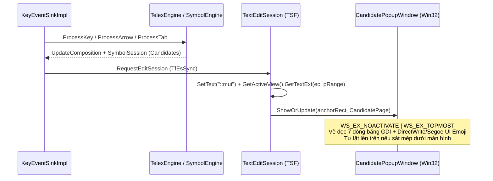

<!--
  BambooMintKey - Vietnamese Telex Input Method Editor for Windows
  Copyright (c) 2026 Dương Gia Long and LMO contributors
  SPDX-License-Identifier: MIT
-->

# 013_02 — Thiết Kế: Popup Chọn Ký Hiệu Chiều Dọc (IME Nhật) & Khôi Phục Bộ Gõ Sau Lock/Unlock (MSIX)

**Mã tài liệu:** `013_02_Symbol_Vertical_Popup_and_SessionRestore_Design`

**Giai đoạn:** Phase 13 — Nâng cấp trải nghiệm chọn ký hiệu & ổn định hóa MSIX

**Thuộc module:** `src/BambooMintKey.Core`, `dicts/symbols-vi.json`, `src/BambooMintKey.NativeBridge`, `src/BambooMintKey.UI`, `tests/BambooMintKey.Core.Tests`

**Tài liệu liên quan:** [013_00_Symbol_Shortcode_Idea.md](./013_00_Symbol_Shortcode_Idea.md), [013_01_Symbol_Shortcode_Sample_Design.md](./013_01_Symbol_Shortcode_Sample_Design.md)

**Trạng thái:** 📝 Bản thiết kế hoàn chỉnh — Chờ duyệt trước khi triển khai code.

---

## Phần A — Cửa Sổ Ứng Viên Chiều Dọc (Vertical Candidate Popup) & Từ Điển Số Khung Tròn / Ô Vuông

### 1. Mục Tiêu UX

Thay vì phải bấm `Tab` xoay từng ký tự một trong Inline Preview, khi người dùng gõ `::từkhóa`, bộ gõ hiển thị **cửa sổ ứng viên chiều dọc (tối đa 7 mục/trang)** ngay dưới con trỏ — giống phong cách bộ gõ tiếng Nhật (MS-IME / Google Japanese Input):

```text
  ::mui
 ┌──────────────────────┐
 │ 1   →                │  ◄ đang chọn (highlight)
 │ 2   ←                │
 │ 3   ↑                │
 │ 4   ↓                │
 │ 5   ⇒                │
 │ 6   ⇔                │
 │ 7   ↔                │
 ├──────────────────────┤
 │ ↑↓/Tab · 1-7     1/1 │
 └──────────────────────┘
```

#### Quy tắc tương tác bàn phím

| Phím                      | Hành vi khi có ứng viên (`Candidates.Length > 0`)                                                                       | Hành vi khi không có ứng viên (`Candidates.Length = 0`)             |
| -------------------------- | ----------------------------------------------------------------------------------------------------------------------------- | -------------------------------------------------------------------------- |
| `↓` hoặc `Tab`       | Di chuyển chọn xuống 1 mục (vòng tròn sang trang sau / quay về đầu)                                                  | `↓`: chốt nguyên văn `::query`; `Tab`: chốt `::query\t`       |
| `↑` hoặc `Shift+Tab` | Di chuyển chọn lên 1 mục (vòng tròn sang trang trước / quay về cuối)                                                | `↑`: chốt nguyên văn `::query`; `Shift+Tab`: chốt `::query\t` |
| `→`                     | Chuyển sang **trang tiếp theo** (giữ vị trí đầu trang mới); nếu chỉ có 1 trang thì di chuyển xuống 1 mục | Chốt nguyên văn `::query`                                             |
| `←`                     | Chuyển sang **trang trước** (vị trí đầu trang); nếu chỉ có 1 trang thì di chuyển lên 1 mục                | Chốt nguyên văn `::query`                                             |
| `1` – `7`             | **Chọn & chốt ngay** ứng viên thứ `k` trong trang hiện tại (nếu `k <= số mục trên trang`)                | Nối ký tự số vào `RawQuery` bình thường                          |
| `Space` / `Enter`      | Chốt ứng viên đang highlight (tiêu thụ phím, không dư khoảng trắng)                                                | Chốt nguyên văn `::query ` / `::query`                              |
| `Esc`                    | Đóng popup, chốt nguyên văn `::query`                                                                                  | Chốt nguyên văn `::query`                                             |
| `Backspace`              | Xóa 1 ký tự cuối của `RawQuery`, lọc lại danh sách & cập nhật popup; nếu xóa hết về `::` thì ẩn popup     | Giống bên trái                                                          |

> **Thiết kế tránh xung đột phím số:** Toàn bộ từ khóa trong `dicts/symbols-vi.json` chỉ dùng **chữ cái thuần** (không chứa chữ số). Nhờ vậy khi đang có danh sách gợi ý (`Candidates.Length > 0`), phím `1`–`7` luôn có ý nghĩa duy nhất là chọn nhanh ứng viên số `1`–`7` trên trang hiện tại.

---

### 2. Mở Rộng Từ Điển `dicts/symbols-vi.json` (Số Khung Tròn & Số Ô Vuông)

Bổ sung các nhóm từ khóa số có khung tròn (trắng / đen) và số có ô vuông (Unicode keycap):

| Từ khóa              | Danh sách ký tự                                                                                                   | Số trang (7 mục/trang) |
| ---------------------- | -------------------------------------------------------------------------------------------------------------------- | ------------------------ |
| `tron`, `sotron`   | `①`, `②`, `③`, `④`, `⑤`, `⑥`, `⑦`, `⑧`, `⑨`, `⑩`, `⑪`, `⑫`, `⓪`               | 2 trang                  |
| `tronden`            | `❶`, `❷`, `❸`, `❹`, `❺`, `❻`, `❼`, `❽`, `❾`, `❿`, `⓿`                               | 2 trang                  |
| `vuong`, `sovuong` | `1️⃣`, `2️⃣`, `3️⃣`, `4️⃣`, `5️⃣`, `6️⃣`, `7️⃣`, `8️⃣`, `9️⃣`, `🔟`, `0️⃣` | 2 trang                  |

*(Giữ nguyên toàn bộ 15 mục mẫu hiện có: `mui`, `tick`, `nhan`, `chia`, `bang`, `do`, `tien`, `sao`, `cham`, `ngoac`, `ok`, `loi`, `canhbao`, `lua`, `vn`.)*

---

### 3. Thay Đổi Ở `BambooMintKey.Core` (F#)

#### 3.1. `Domain/Types.fs`

Bổ sung 4 phím mũi tên vào `KeyInput`:

```fsharp
[<RequireQualifiedAccess>]
type KeyInput =
    | Char of char
    | Backspace
    | WordBreak of char
    | NonCharacter
    | Tab of isShift: bool
    | Escape
    | ArrowUp
    | ArrowDown
    | ArrowLeft
    | ArrowRight
```

*(Trong chế độ Telex thường không ở Symbol mode, 4 phím mũi tên trả về `PassThrough` giống `NonCharacter`, giữ nguyên 100% hành vi cũ.)*

#### 3.2. `Engine/SymbolEngine.fs`

- Hằng số phân trang: `let PageSize = 7`.
- Thêm helper đọc trang hiện tại để tầng NativeBridge (C#) gọi trực tiếp, không cần tính lại:
  ```fsharp
  type CandidatePage = {
      Items: string array      // Tối đa 7 ký tự của trang hiện tại
      SelectedInPage: int      // 0..(Items.Length - 1)
      PageIndex: int           // 0-based
      TotalPages: int          // >= 1
      TotalCount: int
  }
  ```
- Xử lý trong `SymbolEngine.processKey` (trạng thái `Collecting session`):
  - `KeyInput.Char c` khi `c >= '1' && c <= '7'` và `session.Candidates.Length > 0`:
    - Tính `pageStart = (session.SelectedIndex / PageSize) * PageSize`
    - Tính `targetIdx = pageStart + (int c - int '1')`
    - Nếu `targetIdx < session.Candidates.Length` → trả về `Commit session.Candidates[targetIdx]` (`CanStartSymbolTrigger = true`).
    - Nếu vượt quá số mục trên trang (ví dụ trang chỉ có 3 mục mà bấm `5`) → bỏ qua hoặc giữ nguyên trang (không thoát đột ngột).
  - `KeyInput.ArrowDown` → giống `Tab false`: `(SelectedIndex + 1) % n`.
  - `KeyInput.ArrowUp` → giống `Tab true`: `(SelectedIndex - 1 + n) % n`.
  - `KeyInput.ArrowRight` → nếu `TotalPages > 1`: nhảy sang đầu trang kế `((pageIdx + 1) % totalPages) * PageSize`; ngược lại `(SelectedIndex + 1) % n`.
  - `KeyInput.ArrowLeft` → nếu `TotalPages > 1`: nhảy sang đầu trang trước `((pageIdx - 1 + totalPages) % totalPages) * PageSize`; ngược lại `(SelectedIndex - 1 + n) % n`.
- **Chuỗi composition (`formatPreview`):**
  - Core vẫn giữ `TransformedText = formatPreview session` làm fallback an toàn.
  - Khi Windows TSF **hiển thị được Popup**, TSF ghi chuỗi gọn `"::" + session.RawQuery` vào composition (tránh lặp thông tin thừa ngay trên dòng chữ đang gõ); nếu ứng dụng không lấy được tọa độ popup thì tự động dùng chuỗi `formatPreview` (`::mui → (1/7)`).

---

### 4. Thiết Kế Windows TSF Vertical Popup (`BambooMintKey.NativeBridge`)



#### 4.1. Lấy tọa độ con trỏ chính xác (`TSF/TsfTextExtHelper.cs`)

- Gọi ngay bên trong `TextEditSession.PerformUpdateText(uint ec)` khi đang giữ `EditCookie` hợp lệ:
  1. `ITfContext::GetActiveView(&pView)`
  2. `ITfContextView::GetTextExt(ec, pRange, &rc, &fClipped)`
  3. Nếu `SUCCEEDED(hr)` và `rc` hợp lệ (`rc.Bottom > rc.Top`) → dùng `(rc.Left, rc.Bottom)` làm điểm neo popup (và `rc.Top` nếu cần lật lên trên).
  4. **Fallback cấp 1:** `GetGUIThreadInfo` → `rcCaret` + `ClientToScreen(hwndCaret, ...)`.
  5. **Fallback cấp 2:** Nếu cả 2 đều thất bại → ẩn popup và hiển thị chuỗi Inline Preview (`::mui → (1/7)`) trong composition.

#### 4.2. Cửa sổ Popup Win32 siêu nhẹ (`TSF/CandidatePopupWindow.cs`)

- **Kiểu cửa sổ:** `WS_POPUP | WS_BORDER` + Extended Style `WS_EX_NOACTIVATE | WS_EX_TOPMOST | WS_EX_TOOLWINDOW` → **tuyệt đối không cướp focus** của Notepad, Word, Edge, VS Code, Terminal, Electron.
- **Tương thích NativeAOT:** Dùng 100% P/Invoke Win32 (`user32.dll`, `gdi32.dll`), không dùng WinForms/WPF/Avalonia trong DLL in-proc COM (nhẹ, không đụng runtime của app chủ).
- **Tự vẽ (Owner-draw `WM_PAINT`):**
  - Hỗ trợ DPI (`GetDpiForWindow`).
  - Nền sáng/gọn (`#FFFFFF`), viền `#D0D7DE`, dòng đang chọn tô nền `#E8F0FE` với viền trái màu xanh lá nhạt thương hiệu BambooMintKey (`#1B8A5A`).
  - Cột số thứ tự `1`–`7` căn trái (màu xám `#656D76`), cột ký tự/emoji căn rõ ràng (dùng `DrawTextW` với font `Segoe UI` — Windows tự font-fallback sang `Segoe UI Emoji` / `Segoe UI Symbol` cho emoji màu & ký tự vòng tròn).
  - Chân popup hiển thị gợi ý ngắn `↑↓ · 1-7` và số trang `1/2` (khi có > 1 trang).
  - Hỗ trợ **click chuột trực tiếp** vào dòng bất kỳ trong popup? → *Để sau (Bước 2 của Popup)*, ở bước này đặt `WS_EX_NOACTIVATE` và tập trung phím `1–7`, `↑↓←→`, `Tab`, `Space`/`Enter`, `Esc` để tránh mọi rủi ro mất focus trên Electron/UWP.
- **Vòng đời đóng popup an toàn:** Tự động `Hide()` trong mọi tình huống:
  - Khi `Commit` / `CancelComposition` / `EndComposition`.
  - Khi `OnSetFocus(fForeground == 0)` hoặc `OnKillFocus`.
  - Khi `Query` rỗng (lùi về `::` hoặc `:` hoặc `Idle`) hoặc `Candidates.Length == 0`.
  - Khi người dùng bấm `Ctrl/Alt/Win` hoặc chuyển sang chế độ `E`.

#### 4.3. Cập nhật `KeyEventSinkImpl.cs`

- Trong `OnTestKeyDown` và `OnKeyDown`, khi `BridgeStateManager.IsSymbolModeActive`:
  - Ăn thêm 4 mã phím ảo `VK_LEFT (0x25)`, `VK_UP (0x26)`, `VK_RIGHT (0x27)`, `VK_DOWN (0x28)` và chuyển sang `BridgeStateManager.ProcessArrow(...)`.
  - Riêng phím số `0–9`: khi `IsSymbolModeActive`, `hasComp` đã là `true` nên đã được ăn sẵn; `OnKeyDown` chuyển qua `ProcessKey(c)` → `SymbolEngine` tự nhận diện `'1'..'7'` để chọn & chốt ngay.

---

## Phần B — Nguyên Nhân & Thiết Kế Sửa Triệt Để Lỗi Reset Về English IME Sau Khi Khóa Máy / Đăng Nhập Lại Trên MSIX

### 1. Tại sao trước đây (Inno Setup) không bị mà chuyển sang MSIX lại bị?

Đã kiểm tra trực tiếp quyền thư mục (`icacls`) và Registry TSF trên máy của bạn:

| Yếu tố                                                              | Bản cài đặt cũ (Inno Setup)                                                     | Bản MSIX hiện tại                                                                                                                                                                                                                        |
| --------------------------------------------------------------------- | ------------------------------------------------------------------------------------ | ------------------------------------------------------------------------------------------------------------------------------------------------------------------------------------------------------------------------------------------- |
| Vị trí `BambooMintKey.dll`                                        | `C:\Program Files\BambooMintKey\`                                                  | `C:\ProgramData\BambooMintKey\`                                                                                                                                                                                                           |
| Quyền ghi thư mục (`icacls`)                                     | Chỉ `Administrators` / `SYSTEM` được ghi (`BUILTIN\Users` chỉ có `RX`) | Kế thừa từ `C:\ProgramData`: **`BUILTIN\Users:(WD,AD,WEA,WA)`** và user hiện tại **`NTQJ-:(F)`** (user thường ghi được!)                                                                                       |
| Hành vi của Windows `LogonUI.exe` (Secure Desktop khi khóa máy) | Tin cậy thư mục `Program Files`, giữ ngữ cảnh profile bình thường         | Vì bảo mật chống leo thang đặc quyền (LPE), `LogonUI.exe` (chạy dưới `SYSTEM`) từ chối nạp COM DLL nằm trong thư mục user-writable → ép chuyển sang ngôn ngữ #1 trong `SortOrder\Language` (`en-US`, `0409`) |
| Sau khi mở khóa quay lại Desktop                                   | Giữ nguyên bộ gõ đang dùng trước khi khóa                                   | `InputMethodOverride` đang trống nên Windows giữ luôn `en-US` vừa dùng ở màn hình khóa, không tự chuyển lại BambooMintKey                                                                                                |

### 2. Tại sao không chỉ đơn giản xóa quyền ghi user trên `C:\ProgramData\BambooMintKey`?

- Nếu tước quyền ghi của user trên `C:\ProgramData\BambooMintKey`, mỗi lần cài bản MSIX mới, `TsfBootstrapper` (chạy bằng quyền user thường) sẽ không copy đè được DLL mà không nâng quyền, đồng thời Windows vẫn có thể chuyển sang `en-US` ở màn hình khóa để nhập mật khẩu.

### 3. Giải pháp triệt để (100% tương thích MSIX, không làm phiền khi bạn chủ động dùng EN/JP)

Tích hợp bộ theo dõi khóa/mở khóa phiên Windows ngay trong `BambooMintKey.UI` (tiến trình chạy nền sẵn ở khay hệ thống):

1. **Tạo module `SessionRestoreManager` trong `BambooMintKey.UI`** (gắn vào vòng đời của `App.axaml.fs` / `TrayIconManager.fs`):

   - Đăng ký `Microsoft.Win32.SystemEvents.SessionSwitch`.
   - **Khi nhận `SessionSwitchReason.SessionLock`:**
     - Đọc trạng thái hiện tại từ SharedMemory (`IsBambooMintKeyActive`, offset `24`, kết hợp kiểm tra profile TSF đang active qua `ITfInputProcessorProfileMgr::GetActiveProfile`).
     - Lưu cờ `wasBambooActiveBeforeLock : bool`.
   - **Khi nhận `SessionSwitchReason.SessionUnlock`:**
     - Nếu `wasBambooActiveBeforeLock = false` (trước khi khóa bạn đang dùng **English** hoặc **Japanese**): **KHÔNG làm gì cả** — giữ nguyên bộ gõ bạn đang chọn.
     - Nếu `wasBambooActiveBeforeLock = true` (trước khi khóa bạn đang dùng **BambooMintKey**):
       - Chờ ngắn (~400ms trên background thread để Windows hoàn tất chuyển desktop từ `Winlogon` về `Default`).
       - Gọi COM API chuẩn của Windows TSF **`ITfInputProcessorProfileMgr::ActivateProfile`**:
         - `dwProfileType = TF_PROFILETYPE_INPUTPROCESSOR (1)`
         - `langid = 0x042A` (Vietnamese)
         - `clsid = {B8A5A29D-68B1-4A59-B41E-D8B383D6F2C1}`
         - `guidProfile = {C2F31A8E-92D0-4F81-9C3E-A52889211D44}`
         - `dwFlags = TF_IPPMF_FORSESSION | TF_IPPMF_ENABLEPROFILE`
       - Nếu lần đầu chưa kịp hiệu lực (desktop vừa tỉnh giấc từ Sleep/Hibernate), thử lại tối đa 1 lần nữa sau 800ms nếu kiểm tra thấy profile vẫn đang bị kẹt ở `en-US`.
   - Hủy đăng ký sự kiện sạch sẽ khi `App` thoát để tránh memory leak.
2. **Đánh giá ảnh hưởng tới các phần cũ:**

   - **Không chạm vào `TsfRegistration` hay `TsfBootstrapper`** (giữ nguyên toàn bộ cơ chế đăng ký MSIX hiện tại).
   - **Không ép chuyển bộ gõ** khi đang dùng bình thường, chỉ chạy đúng 1 lần tại sự kiện `SessionUnlock` và **chỉ khi** trước lúc khóa máy bạn thực sự đang chọn BambooMintKey.

---

## Phần C — Danh Sách File Dự Kiến Tạo / Chỉnh Sửa

| Phần              | Thao tác   | Đường dẫn                                                                          | Nội dung                                                                                             |
| ------------------ | ----------- | -------------------------------------------------------------------------------------- | ----------------------------------------------------------------------------------------------------- |
| **A (Core)** | Chỉnh sửa | `dicts/symbols-vi.json`                                                              | Thêm `tron`, `sotron`, `tronden`, `vuong`, `sovuong`                                       |
| **A (Core)** | Chỉnh sửa | `src/BambooMintKey.Core/Domain/Types.fs`                                             | Thêm `ArrowUp`, `ArrowDown`, `ArrowLeft`, `ArrowRight` vào `KeyInput`                     |
| **A (Core)** | Chỉnh sửa | `src/BambooMintKey.Core/Engine/SymbolEngine.fs`                                      | Phân trang 7 mục (`CandidatePage`), xử lý phím số `1–7` và 4 phím mũi tên              |
| **A (Core)** | Chỉnh sửa | `src/BambooMintKey.Core/Engine/TelexEngine.fs`                                       | PassThrough cho 4 phím mũi tên ngoài Symbol mode                                                  |
| **A (TSF)**  | Tạo mới   | `src/BambooMintKey.NativeBridge/TSF/TsfTextExtHelper.cs`                             | Lấy tọa độ `ITfContextView::GetTextExt` + fallback `GetGUIThreadInfo`                         |
| **A (TSF)**  | Tạo mới   | `src/BambooMintKey.NativeBridge/TSF/CandidatePopupWindow.cs`                         | Cửa sổ popup Win32 chiều dọc 7 mục (`WS_EX_NOACTIVATE`)                                        |
| **A (TSF)**  | Chỉnh sửa | `src/BambooMintKey.NativeBridge/TSF/BridgeStateManager.cs`                           | Thêm `ProcessArrow`, `TryGetCurrentCandidatePage`                                                |
| **A (TSF)**  | Chỉnh sửa | `src/BambooMintKey.NativeBridge/TSF/TextEditSession.cs`                              | Gọi `TsfTextExtHelper` & cập nhật/ẩn `CandidatePopupWindow`                                   |
| **A (TSF)**  | Chỉnh sửa | `src/BambooMintKey.NativeBridge/TSF/KeyEventSinkImpl.cs`                             | Nuốt 4 phím mũi tên trong Symbol mode, ẩn popup khi mất focus / tắt mode                       |
| **B (MSIX)** | Tạo mới   | `src/BambooMintKey.UI/SessionRestoreManager.fs`                                      | Lắng nghe `SessionLock` / `SessionUnlock` và khôi phục TSF profile                            |
| **B (MSIX)** | Chỉnh sửa | `src/BambooMintKey.UI/App.axaml.fs` & `BambooMintKey.UI.fsproj`                    | Khởi chạy `SessionRestoreManager` cùng `TrayIconManager`                                       |
| **Tests**    | Chỉnh sửa | `tests/BambooMintKey.Core.Tests/SymbolDictionaryTests.fs` & `SymbolEngineTests.fs` | Test đầy đủ từ khóa số tròn/vuông, chọn số `1–7`, phân trang 7 mục, 4 phím mũi tên |

---

## Các Điểm Xác Nhận Trước Khi Triển Khai

1. **Từ khóa số khung tròn & ô vuông:** `::tron` (`①..⑫ ⓪`), `::tronden` (`❶..❿ ⓿`), `::vuong` (`1️⃣..🔟 0️⃣`) (kèm alias `::sotron`, `::sovuong`) đã thuận tay bạn chưa?
2. **Popup chiều dọc:** 7 mục/trang, hiển thị số `1–7` + ký tự, `↑↓` hoặc `Tab` để chọn, `←→` để lật trang khi > 7 mục, `1–7` để chốt ngay, và trong ô text lúc có popup chỉ hiện gọn `::mui` — bạn chốt thiết kế này chứ?
3. **Khôi phục sau Lock/Unlock:** Bạn đồng ý triển khai cả **Phần A** và **Phần B** trong lượt code tiếp theo?
