<!--
  BambooMintKey - Vietnamese Telex Input Method Editor for Windows
  Copyright (c) 2026 Dương Gia Long and LMO contributors
  SPDX-License-Identifier: MIT
-->

# 013_03 — Thiết Kế Kiến Trúc Out-of-Process: Popup Chọn Ký Hiệu Bằng Avalonia (`BambooMintKey.UI`)

**Mã tài liệu:** `013_03_Avalonia_Candidate_Popup_Design`

**Giai đoạn:** Phase 13 — Chuyển Popup chọn ký hiệu sang tiến trình UI Avalonia (thay thế hoàn toàn Win32 GDI trong DLL)

**Thuộc module:** `src/BambooMintKey.NativeBridge`, `src/BambooMintKey.UI`, `tests/BambooMintKey.NativeBridge.Tests`

**Tài liệu liên quan:** [013_01_Symbol_Shortcode_Sample_Design.md](./013_01_Symbol_Shortcode_Sample_Design.md), [013_02_Symbol_Vertical_Popup_and_SessionRestore_Design.md](./013_02_Symbol_Vertical_Popup_and_SessionRestore_Design.md)

**Trạng thái:** ✅ Thiết kế chuẩn thay thế phần Win32 GDI của `013_02`.

---

## 1. Lý Do Chuyển Từ Win32 GDI (In-Process) Sang Avalonia (Out-of-Process)

1. **Cách ly tuyệt đối với tiến trình app chủ:** `BambooMintKey.dll` chạy in-process bên trong Notepad, Explorer (`WinUIEdit.dll`), Edge, Word, VS Code. Bỏ hoàn toàn việc tạo cửa sổ Win32 và bỏ hoàn toàn lời gọi COM `ITfContext::GetActiveView` / `ITfContextView::GetTextExt` trong `NativeBridge` giúp `TextEditSession` trở về đúng sự đơn giản và ổn định tuyệt đối của `013_01`.
2. **Giao diện đẹp & linh hoạt bằng Avalonia (Skia/DirectWrite):** Bo góc mượt, đổ bóng mềm, hỗ trợ emoji màu (`✅ ⚠️ 🇻🇳 1️⃣ ①`) sắc nét, DPI đa màn hình tự động, dễ mở rộng theme sáng/tối đồng bộ với Settings GUI.
3. **Đồng bộ kiến trúc sẵn có:** Tận dụng chính tiến trình `BambooMintKey.UI` đang chạy nền cùng cơ chế SharedMemory + Named Event (`UniversalSddl` hỗ trợ AppContainer / Low Integrity) như `SharedMemoryManager` và `TrayIconManager`.

---

## 2. Kiến Trúc & Giao Thức IPC

```mermaid
flowchart LR
    A["App đang gõ (Notepad/Explorer/Edge)"] --> B["BambooMintKey.dll (NativeBridge)"]
    B -- "1. SetText (không gọi COM GetTextExt)" --> A
    B -- "2. Ghi SharedMemory + SetEvent" --> C["Local\\BambooMintKey_CandidatePopup_v1\n(1024 bytes, UniversalSddl)"]
    C -- "3. Event wakeup < 1ms" --> D["BambooMintKey.UI (Avalonia)"]
    D -- "4. Vẽ Popup dọc (WS_EX_NOACTIVATE)" --> E["Màn hình người dùng (không cướp focus)"]
```

### 2.1. Định dạng SharedMemory (`Local\BambooMintKey_CandidatePopup_v1`, 1024 bytes)

- **Named Event:** `Local\BambooMintKey_CandidatePopupEvent_v1` (AutoReset)
- **SDDL:** `D:(A;;GA;;;WD)(A;;GA;;;AC)(A;;GA;;;S-1-15-2-2)S:(ML;;NW;;;LW)` (tương thích UWP/Edge/Low Integrity)

| Offset | Kiểu | Trường | Ý nghĩa |
|---|---|---|---|
| `0` | `int32` | `Sequence` | Số thứ tự tăng dần mỗi lần cập nhật |
| `4` | `int32` | `Visible` | `1` = hiện popup, `0` = ẩn popup |
| `8..23` | `4 × int32` | `AnchorLeft/Top/Right/Bottom` | Tọa độ màn hình (physical px) lấy từ `GetGUIThreadInfo` hoặc `GetCursorPos` |
| `24` | `int32` | `SelectedInPage` | Chỉ số đang chọn trên trang (`0..6`) |
| `28` | `int32` | `PageIndex` | Chỉ số trang hiện tại (0-based) |
| `32` | `int32` | `TotalPages` | Tổng số trang (`>= 1`) |
| `36` | `int32` | `TotalCount` | Tổng số ứng viên khớp |
| `40` | `int32` | `ItemCount` | Số ứng viên trên trang (`0..7`) |
| `44` | `int32` | `HasCaretAnchor` | `1` = từ `GetGUIThreadInfo`, `0` = fallback từ `GetCursorPos` |
| `48` | `int32` | `PayloadByteLen` | Độ dài UTF-8 của payload |
| `52..1023` | `byte[972]` | `PayloadUtf8` | Dòng 0 = `RawQuery`, các dòng `1..ItemCount` = từng ứng viên (ngăn cách bằng `\n`) |

### 2.2. Quy tắc Fallback An Toàn

- Nếu `BambooMintKey.UI` đang chạy (mở được `Local\BambooMintKey_UI_SingleInstance_Mutex`): `NativeBridge` giữ composition gọn `::mui` và gửi trạng thái qua SharedMemory để Avalonia vẽ popup dọc.
- Nếu `BambooMintKey.UI` không chạy: `NativeBridge` tự động fallback về **Inline Preview** (`::mui → (1/7)`), người dùng vẫn chọn được bằng `↑↓`, `Tab`, `1–7`, `Space`/`Enter`.

---

## 3. Thiết Kế Giao Diện Avalonia (`CandidatePopupWindow.fs`)

- **Thuộc tính cửa sổ không cướp focus:**
  - Avalonia: `ShowActivated = false`, `Focusable = false`, `Topmost = true`, `ShowInTaskbar = false`, `SystemDecorations = SystemDecorations.None`, `CanResize = false`, `Background = Brushes.Transparent`, `SizeToContent = SizeToContent.WidthAndHeight`.
  - Win32 HWND (áp dụng khi `Opened`): thêm cờ `WS_EX_NOACTIVATE | WS_EX_TOOLWINDOW | WS_EX_TOPMOST` qua `SetWindowLongPtrW(GWL_EXSTYLE)`.
- **Bố cục dọc (7 mục/trang, phong cách IME Nhật hiện đại):**
  - Card bo góc `10px`, nền trắng `#FFFFFF`, viền `#D0D7DE`, đổ bóng nhẹ.
  - Header gọn: `::mui` + nhãn số kết quả (`7` / `20`).
  - Tối đa 7 dòng dọc: số thứ tự `1..7` + ký tự/emoji; dòng đang chọn có nền xanh mint `#E8F5EE` và thanh nhấn `#1B8A5A`.
  - Footer: `↑↓ · ←→ · 1-7` bên trái, chỉ số trang `1/3` bên phải khi có nhiều trang.
- **Định vị thông minh:** Neo ngay dưới `AnchorBottom + 6px`; tự lật lên trên `AnchorTop - height - 6px` nếu gần mép dưới màn hình (`Screens.ScreenFromPoint`).
