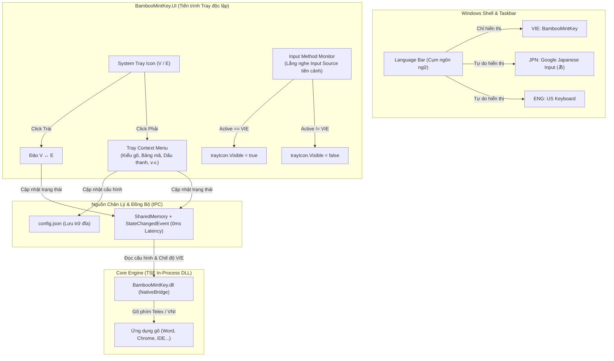

<!--
  BambooMintKey - Vietnamese Telex Input Method Editor for Windows
  Copyright (c) 2026 Dương Gia Long and LMO contributors
  SPDX-License-Identifier: MIT
-->

# Kế Hoạch & Thiết Kế Kiến Trúc: Tách Riêng UI Tray Icon Độc Lập Cho Windows (Tương Tự macOS)

**Mã tài liệu:** `024_Windows_TrayIcon_Separation_Design_And_Plan`  
**Ngày lập:** 12/10/2026  
**Trạng thái:** ✅ Đã hoàn thành, nghiệm thu thực tế và phát hành trong phiên bản **1.2.0**  
**Tác giả:** BambooMintKey Core Team & Architecture Review  

---

## 1. Bối cảnh & Nhận định Vấn đề (Context & Problem Analysis)

### 1.1. Thực trạng kiến trúc cũ trên Windows
Trong các phiên bản trước đây của BambooMintKey trên Windows:
* Biểu tượng **E/V** được tích hợp thẳng vào bên trong thư viện `BambooMintKey.dll` (NativeBridge TSF) dưới dạng một **COM Language Bar Item Button (`ITfLangBarItemButton`)**.
* Thư viện `BambooMintKey.dll` là thư viện **In-Process**: Mỗi ứng dụng mở trên Windows (Opera, Chrome, Notepad, VS Code, Discord...) đều nạp một bản sao DLL riêng vào tiến trình đó.
* Windows Taskbar chỉ có **duy nhất 1 slot hiển thị** cho nút điều khiển chế độ nhập liệu (Input Mode Control).

### 1.2. Hậu quả của kiến trúc cũ (Gốc rễ lỗi Issue 023)
* **Xung đột đa tiến trình (Multi-process Conflict):** Khi người dùng chuyển đổi bộ gõ ở cửa sổ tiền cảnh (ví dụ Opera), Opera ra lệnh hủy kích hoạt, nhưng các ứng dụng nền khác (như Antigravity IDE) vẫn giữ kết nối COM với Taskbar.
* **Cướp quyền của bộ gõ bên thứ 3:** Khi chuyển sang **Google Japanese Input (Mozc)**, Google IME cũng là một bộ gõ bên thứ 3 và cần gọi `ITfLangBarItemMgr::AddItem` vào đúng slot đó. Do slot Taskbar vẫn bị các tiến trình nền của BambooMintKey chiếm giữ, Windows từ chối đăng ký của Google IME $\rightarrow$ Biểu tượng `あ` / `A` của Google IME bị mất hoàn toàn, còn icon `E/V` của BambooMintKey bị "nằm lì" cố định.
* **Cố gắng chữa lỗi sai hướng:** Việc can thiệp liên tục vào sự kiện Focus (`OnSetFocus`) để `AddItem` / `RemoveItem` tạo ra tình trạng giằng co (race condition) giữa các ứng dụng chạy song song: Chỉ hoạt động được 1 lần sau khi khởi động sạch, nhưng ngay sau đó khi mở ứng dụng thứ 2 thì bị kẹt trở lại.

### 1.3. Bài học thành công từ nền tảng macOS
Bên macOS, chúng ta đã giải quyết bài toán này cực kỳ sạch sẽ và ổn định 100%:
* `BambooMintKey.Mac.IMK`: Bộ gõ lõi chỉ làm nhiệm vụ xử lý ký tự, không gánh bất kỳ UI nào.
* `BambooMintKey.Mac.StatusBar`: Một ứng dụng chạy nền độc lập trên Menu Bar (`NSStatusItem`).
* Toàn bộ cài đặt nhanh được đưa vào Context Menu của Menu Bar và đồng bộ qua `config.json`.
* Cơ chế ẩn/hiện chỉ vỏn vẹn một logic đơn giản:
  ```swift
  private func updateVisibility() {
      statusItem.isVisible = isBambooMintKeyActive()
  }
  ```
  $\rightarrow$ Khi chọn BambooMintKey thì Menu Bar hiện icon. Khi chuyển sang tiếng Nhật hay tiếng Anh, icon tự động ẩn đi trong 0ms. Không bao giờ xung đột với bất kỳ bộ gõ nào.

---

## 2. Mục Tiêu Thiết Kế Mới (Design Goals)

1. **Phân tách rạch ròi trách nhiệm (Separation of Concerns):**
   * **Bên Language Bar (Taskbar Input Indicator):** Chỉ hiển thị duy nhất profile chuẩn của Windows: `VIE: BambooMintKey`. **Gỡ bỏ hoàn toàn mọi COM LangBar Item Button khỏi Language Bar.**
   * **Bên Khay Hệ Thống (System Tray Icon - Notification Area):** Tạo một Tray Icon độc lập do tiến trình UI quản lý, chứa đầy đủ menu thiết lập nhanh và đồng bộ hai chiều qua `config.json` + `SharedMemory`.
2. **Không còn bất kỳ xung đột nào với các bộ gõ khác:**
   * Google Japanese Input (Mozc) và Microsoft Japanese IME có 100% không gian Taskbar của riêng mình để hiển thị biểu tượng `あ` / `A`.
3. **Cơ chế Tự động Ẩn / Hiện (Auto-Visibility):**
   * Khi cửa sổ hiện tại đang chọn bộ gõ `VIE: BambooMintKey` $\rightarrow$ Tray Icon **HIỆN**.
   * Khi cửa sổ hiện tại chuyển sang bộ gõ khác (`JPN: Google Japanese Input`, `ENG: US Keyboard`...) $\rightarrow$ Tray Icon **ẨN**.
4. **Đồng nhất trải nghiệm người dùng trên cả 3 hệ điều hành:**
   * **macOS:** Menu Bar icon (V/E).
   * **Linux:** Fcitx5 Tray / AppIndicator.
   * **Windows:** System Tray icon (quen thuộc với người dùng Việt Nam từ thời UniKey / EVKey).

---

## 3. Kiến Trúc Chi Tiết (Detailed Architecture)



---

## 4. Chi Tiết Kỹ Thuật Từng Thành Phần

### 4.1. Điều chỉnh `BambooMintKey.NativeBridge` (Dọn sạch Taskbar)
* **Xóa bỏ vĩnh viễn việc đăng ký `LangBarItemButton`:**
  * Trong [BambooMintKeyTextService.cs](file:///d:/Kojin/BambooMintKey/src/BambooMintKey.NativeBridge/TSF/BambooMintKeyTextService.cs):
    * Loại bỏ `LangBarItemButton.Register(pThreadMgr, tfClientId);` trong `ActivateExImpl`.
    * Loại bỏ `LangBarItemButton.Unregister();` trong `DeactivateImpl` và `OnSetFocus`.
  * Không còn bất kỳ tiến trình nào gọi `ITfLangBarItemMgr::AddItem` chiếm slot của Taskbar.
* **Cung cấp trạng thái kích hoạt cho hệ thống:**
  * Khi `ActivateExImpl` được gọi ở tiến trình tiền cảnh: Ghi nhận cờ trạng thái `IsBambooMintKeyActive = true` vào `SharedMemory`.
  * Khi `DeactivateImpl` được gọi: Ghi nhận `IsBambooMintKeyActive = false`.

### 4.2. Xây dựng Tray Icon trong `BambooMintKey.UI`
* **Vòng đời chạy nền (Background Lifecycle):**
  * `BambooMintKey.UI.exe` sẽ chạy nền liên tục (được kích hoạt cùng Windows qua khóa Registry `Software\Microsoft\Windows\CurrentVersion\Run`).
  * Khởi động với tham số ngầm (hoặc tự động ẩn cửa sổ chính `MainWindow`, chỉ hiện Tray Icon).
  * Khi người dùng đóng cửa sổ cài đặt chính (`MainWindow` bấm [X] hoặc bấm "Lưu thiết lập"): Cửa sổ chỉ ẩn đi (`Hide`), không thoát tiến trình.
  * Chỉ khi người dùng chọn **"Thoát BambooMintKey"** từ Tray Menu thì tiến trình mới chấm dứt hoàn toàn.
* **Biểu tượng hiển thị (Dynamic Icon):**
  * Sử dụng 2 biểu tượng chuẩn thương hiệu:
    * `icon_v.ico`: Chữ **V** màu trắng trên nền xanh lá (`#16a34a`).
    * `icon_e.ico`: Chữ **E** màu trắng trên nền xanh lá (`#16a34a`).
  * Tự động chuyển đổi icon ngay lập tức khi chế độ gõ thay đổi (lắng nghe `Local\BambooMintKey_StateChangedEvent_v1`).

### 4.3. Cấu trúc Menu Ngữ Cảnh Chuột Phải (Tray Context Menu)
Context Menu trên Tray Icon được thiết kế chuẩn xác, trực quan, hỗ trợ đầy đủ các tùy chọn như phiên bản macOS:

```text
[•] Tiếng Việt (V)
[ ] Tiếng Anh (E)
----------------------------------------
Kiểu gõ                               >
    [•] Telex
    [ ] VNI
    [ ] Simple Telex
Bảng mã                               >
    [•] Unicode dựng sẵn
    [ ] Unicode tổ hợp
    [ ] TCVN3 (ABC)
Kiểu đặt dấu thanh                    >
    [•] Kiểu mới (òa, xòe, thủy)
    [ ] Kiểu cũ (oà, xoè, thuỷ)
----------------------------------------
[✓] Cho phép bỏ dấu tự do
[✓] Gõ lặp dấu để khôi phục (ss -> s)
[ ] Phím 'w' đầu từ thành 'ư' (w -> ư)
[✓] Tự động nhận diện từ tiếng Anh
----------------------------------------
⚙  Bảng điều khiển & Cài đặt...
ℹ  Thông tin BambooMintKey...
----------------------------------------
✖  Thoát BambooMintKey
```

* Toàn bộ thao tác click vào các mục menu sẽ:
  1. Ghi ngay vào `AppConfig` và lưu ra tệp `config.json`.
  2. Cập nhật các byte tương ứng trong `SharedMemory` (`Local\BambooMintKey_SharedConfig_v1`).
  3. Bắn tín hiệu `Local\BambooMintKey_StateChangedEvent_v1` để tất cả các ứng dụng đang gõ áp dụng cấu hình mới ngay lập tức trong 0ms.

### 4.4. Cơ Chế Tự Động Ẩn/Hiện Tray Icon (Auto-Visibility)
Tương tự hàm `isBambooMintKeyActive()` bên macOS, trên Windows chúng ta áp dụng cơ chế xác định Input Method hiện tại của cửa sổ đang active:

1. **Win32 Active Keyboard Layout Detection:**
   * Sử dụng hàm Win32 chuẩn:
     ```csharp
     IntPtr hwndForeground = GetForegroundWindow();
     uint threadId = GetWindowThreadProcessId(hwndForeground, out _);
     IntPtr hkl = GetKeyboardLayout(threadId);
     ```
   * Kiểm tra mã ngôn ngữ (Primary Language ID) của `hkl`:
     * Mã tiếng Việt chuẩn của BambooMintKey: `0x042A` (Vietnamese).
     * Hoặc kiểm tra xem `hkl` có khớp với HKL mà Windows gán cho BambooMintKey Profile hay không.
2. **TSF Active Language Profile Check (Dự phòng chuẩn xác cao):**
   * Sử dụng interface COM nhẹ `ITfInputProcessorProfiles::GetActiveLanguageProfile(Guids.TextServiceClsid, ...)`.
3. **Bộ điều phối hiển thị (Visibility Dispatcher):**
   * Lắng nghe sự kiện đổi cửa sổ của Windows qua `SetWinEventHook(EVENT_SYSTEM_FOREGROUND)` hoặc kiểm tra theo chu kỳ timer ngắn (150ms).
   * Nếu `IsBambooMintKeyActive() == true`:
     $$\text{TrayIcon.Visible} = \text{true}$$
   * Nếu người dùng chuyển sang Google Japanese Input (`0x0411`), Microsoft Japanese IME, hoặc US English (`0x0409`):
     $$\text{TrayIcon.Visible} = \text{false}$$

---

## 5. Kế Hoạch Triển Khai Tuần Tự (Implementation Plan)

| Giai đoạn | Nội dung công việc | File ảnh hưởng | Kết quả đầu ra |
| :--- | :--- | :--- | :--- |
| **Giai đoạn 1** | **Dọn sạch Taskbar TSF:** Vô hiệu hóa việc đăng ký `LangBarItemButton` khỏi `BambooMintKeyTextService`. | `src/BambooMintKey.NativeBridge/TSF/BambooMintKeyTextService.cs` | Taskbar chỉ còn `VIE: BambooMintKey`, không còn icon con nào. Google Japanese Input lập tức hết bị xung đột. |
| **Giai đoạn 2** | **Xây dựng Tray Manager trong UI:** Bổ sung lớp quản lý Tray Icon, icon V/E động và Context Menu với đầy đủ các thiết lập. | `src/BambooMintKey.UI/TrayIconManager.fs` (hoặc `.cs`)<br/>`src/BambooMintKey.UI/Program.fs` | Tray Icon xuất hiện ở khay hệ thống, click đổi V/E, chuột phải có đầy đủ menu. |
| **Giai đoạn 3** | **Tích hợp Auto-Visibility:** Viết module phát hiện Input Method đang chọn ở cửa sổ tiền cảnh để ẩn/hiện Tray Icon. | `src/BambooMintKey.UI/InputMethodMonitor.fs`<br/>`src/BambooMintKey.UI/TrayIconManager.fs` | Chuyển sang Google IME $\rightarrow$ icon ẩn. Chuyển về BambooMintKey $\rightarrow$ icon hiện. |
| **Giai đoạn 4** | **Vòng đời chạy nền & Bộ cài đặt:** Cấu hình để UI khởi động thu nhỏ xuống khay khi bật máy, đóng cửa sổ thì ẩn chứ không thoát. Cập nhật Inno Setup script. | `src/BambooMintKey.UI/MainWindow.axaml.fs`<br/>`delivery/installer/installer.iss` | Cài đặt xong phần mềm tự chạy nền ở Tray Icon. |
| **Giai đoạn 5** | **Kiểm thử nghiệm thu:** Biên dịch NativeAOT & UI, kiểm thử thực tế trên máy người dùng theo 6 kịch bản. | `tests/...`<br/>`scripts/update_local_dll.ps1` | Toàn bộ các bộ gõ hoạt động hài hòa 100%. |

---

## 6. Kịch Bản Kiểm Thử Nghiệm Thu (Acceptance Test Matrix)

| STT | Kịch bản kiểm thử | Hành động | Kết quả mong đợi |
| :---: | :--- | :--- | :--- |
| **TC1** | **Chuyển sang Google Japanese Input** | Nhấn `Win + Space` chuyển từ BambooMintKey sang Google IME trong Opera / Notepad. | Taskbar hiện biểu tượng `あ` của Google Japanese Input. Icon E/V ở khay hệ thống tự động **ẨN**. |
| **TC2** | **Chuyển lại BambooMintKey** | Nhấn `Win + Space` quay lại BambooMintKey. | Taskbar hiện `VIE`. Icon E/V ở khay hệ thống tự động **HIỆN** trở lại. |
| **TC3** | **Chuyển sang Microsoft Japanese IME** | Nhấn `Win + Space` chuyển sang MS Japanese IME. | Taskbar hiện `あ` của Microsoft. Icon E/V ở khay hệ thống **ẨN**. |
| **TC4** | **Chuyển sang US English Keyboard** | Nhấn `Win + Space` chuyển sang English. | Taskbar hiện `ENG`. Icon E/V ở khay hệ thống **ẨN**. |
| **TC5** | **Thao tác nhanh trên Tray Menu** | Click chuột phải vào Tray Icon $\rightarrow$ đổi kiểu gõ sang VNI hoặc đổi bảng mã. | Tùy chọn được ghi vào `config.json`, ứng dụng đang gõ lập tức chuyển sang chế độ gõ mới. |
| **TC6** | **Chuyển chế độ bằng phím tắt / click** | Nhấn phím tắt chuyển chế độ (hoặc click chuột trái Tray Icon). | Icon ở khay đổi ngay giữa **V** $\leftrightarrow$ **E** trong 0ms. |

---

## 7. Báo Cáo & Yêu Cầu Phê Duyệt

Tài liệu thiết kế chi tiết này đã phân tích tường tận nguyên nhân gốc rễ, kế thừa triết lý kiến trúc đã được kiểm chứng thành công trên macOS, và vạch ra lộ trình 5 giai đoạn thực hiện cụ thể.

Kính trình anh xem xét và phê duyệt thiết kế để tiến hành thực thi mã nguồn.
