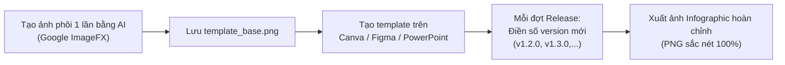

# BambooMintKey — Prompt Mẫu Thiết Kế Infographic Tổng Quan Dự Án
> **Ngày tạo:** 13/10/2026  
> **Dự án:** [BambooMintKey](file:///d:/Kojin/BambooMintKey/README.md) — Cross-Platform Vietnamese Telex IME (.NET 10, F# & NativeAOT)  
> **Mục tiêu:** Tạo Infographic phong cách Anime 2D trực quan hóa tính đa nền tảng (Cross-platform) và trạng thái phát hành (Release Status) của 3 hệ điều hành.  
> **Công cụ mục tiêu:** Google Image Gen (Imagen 3 / Google ImageFX / Gemini Image Generation).

---

## 1. Thông Tin Trọng Tâm Cần Thể Hiện (Core Facts)

### 1.1. Kiến Trúc Tổng Quan 3 Nền Tảng

```text
┌────────────────────────────────────────────────────────────────────────┐
│               BambooMintKey.Core (F# Pure Functional)                 │
│         Telex Engine • Syllable Parser • Unicode Tables (100% Shared) │
├────────────────────────────────────────────────────────────────────────┤
│             C# NativeAOT Bridge / C-ABI (Zero Dependency)              │
├────────────────────┬────────────────────┬──────────────────────────────┤
│      Windows       │       Linux        │            macOS             │
│  TSF In-Proc COM   │  Fcitx5 C++ Addon  │     Apple InputMethodKit     │
│  (BambooMintKey.dll)│ (libbamboomintkey.so)│     (BambooMintKey.app)      │
│  Tray Applet + GUI │  D-Bus + Avalonia  │   Status Bar Applet + GUI    │
├────────────────────┼────────────────────┼──────────────────────────────┤
│     v1.2.0         │       v1.1.5       │            v1.2.0            │
│  (Microsoft Store) │(DEB/RPM/SteamDeck) │       (DMG / Homebrew)       │
└────────────────────┴────────────────────┴──────────────────────────────┘
```

- **Tầng Lõi Dùng Chung (Shared Core Engine - 100%):** `BambooMintKey.Core` viết bằng **F# thuần chức năng (Pure Functional)**, xử lý quy tắc âm tiết tiếng Việt, gõ Telex, bộ từ điển đông kết (`FrozenDictionary`), độc lập hoàn toàn với OS.
- **Tầng Cầu Nối Native (Zero-Dependency):** Biên dịch qua **.NET 10 NativeAOT** thành C-ABI không phụ thuộc CLR/runtime, độ trễ tiệm cận 0ms (<0.1ms).
- **Hệ thống 3 nền tảng chuẩn hệ điều hành (Native Framework Integration, không dùng hook phím / SendInput):**
  1. **Windows:** TSF (Text Services Framework) In-Process COM Server (`BambooMintKey.dll`), Taskbar EV icon độc lập tự động quản lý vòng đời, cấu hình qua Shared Memory Win32, Settings GUI Avalonia Desktop.
  2. **Linux & Steam Deck:** Fcitx5 Framework addon C++ (`libbamboomintkey.so`), gọi lõi qua `BambooMintKeyCore.so`, đồng bộ D-Bus `ModeChanged`, Flatpak Addon Extension cho Steam Deck/SteamOS (an toàn trên phân vùng A/B Read-Only), Settings GUI Avalonia.
  3. **macOS:** Apple InputMethodKit (IMK) Cocoa Client (`BambooMintKey.app` / Swift), nạp dynamic library `libBambooMintKeyCore.dylib`, Status Bar icon quản lý phiên V/E, Settings GUI Avalonia macOS.

### 1.2. Trạng Thái Phiên Bản Phát Hành Hiện Tại

| Nền Tảng | Phiên Bản | Tag Git | Kênh Phân Phối / Gói Cài | Trạng Thái |
|---|:---:|:---:|---|:---:|
| **Windows** | **v1.2.0** | `windows-v1.2.0` | Microsoft Store, Inno Setup Installer (`.exe`), WinGet | ✅ Hoạt động ổn định |
| **Linux & SteamOS** | **v1.1.5** | `linux-v1.1.5` | Flathub Flatpak, Ubuntu/Debian (`.deb`), Fedora (`.rpm`), `.tar.gz` | ✅ Hoạt động ổn định |
| **macOS** | **v1.2.0** | `macos-v1.2.0` | Apple Bundle (`.app`), File ảnh đĩa (`.dmg`) | ✅ Hoạt động ổn định |

---

## 2. Gợi Ý Bổ Sung Cho Infographic & Kích Thước Ảnh

### 2.1. Các Thông Tin Đắt Giá Nên Đưa Vào
1. **Khẩu hiệu cốt lõi (Tagline):** *"Zero-Dependency • Pure Functional F# • Sub-millisecond NativeAOT"*.
2. **So sánh sự khác biệt:**
   - *Bộ gõ cũ:* Dùng global keyboard hook (`SetWindowsHookEx`, `XTest`, `CGEventTap`), giả lập phím ảo (`SendInput`), dễ bị antivirus chặn hoặc giật lag trong game.
   - *BambooMintKey:* Tích hợp native trực tiếp vào hệ thống con IME chuẩn (TSF / Fcitx5 / IMK), không phím ảo, an toàn anti-cheat.
3. **Tính năng gõ thông minh:**
   - Tự động phục hồi từ tiếng Anh sai chính tả tiếng Việt.
   - Bỏ dấu tự do, lặp phím xóa dấu (`ss` $\rightarrow$ `s`).
   - Mở rộng phím `w` biến đổi linh hoạt thành `ư`.
4. **Màu sắc chủ đạo (Brand Palette):**
   - **Xanh bạc hà (Mint Green - `#48D1CC` / `#00E5A3`)**: Đại diện cho sự tươi mới, tốc độ, mượt mà.
   - **Xanh lá tre (Bamboo Green - `#2E8B57` / `#1F9D55`)**: Đại diện cho gốc rễ văn hóa Việt, thanh tao, vững chãi.
   - **Màu nền sáng sủa (Pastel Minimalist / Clean White Slate - `#F8FAFC` & `#1E293B`)**: Phong cách Studio anime hiện đại.

### 2.2. Kích Thước & Tỷ Lệ Ảnh Đề Xuất (Aspect Ratios)

| Mục Đích Sử Dụng | Tỷ Lệ (Aspect Ratio) | Độ Phân Giải (Resolution) | Đánh Giá Phù Hợp Cho Google Image Gen |
|---|:---:|:---:|---|
| **Báo cáo kỹ thuật / Slide Presentation** | **16:9** *(Ngang)* | `1920 x 1080` hoặc `2560 x 1440` | ⭐⭐⭐⭐⭐ **Khuyên dùng nhất**: Bố cục 3 cột tương ứng 3 nền tảng nằm ngang rất thoáng đãng. |
| **Social Feed / Mobile dọc (Facebook, LinkedIn)** | **4:5** hoặc **3:4** *(Dọc vừa)* | `1080 x 1350` hoặc `1200 x 1600` | ⭐⭐⭐⭐ Đọc trên điện thoại sắc nét, layout dạng thác nước (Waterfall). |
| **Story / TikTok / Repertoire Banner** | **9:16** *(Dọc dài)* | `1080 x 1920` | ⭐⭐⭐ Phù hợp dạng infographic cuộn, 3 tầng nền tảng xếp theo chiều dọc. |
| **Avatar / Card quảng bá GitHub Readme** | **1:1** *(Vuông)* | `1024 x 1024` hoặc `2048 x 2048` | ⭐⭐⭐ Dạng huy hiệu / Mascot ôm 3 logo hệ điều hành. |

---

## 3. Bộ Prompt Chuẩn Cho Google Image Gen

> [!TIP]
> **Kinh nghiệm sử dụng Google Image Gen (Imagen 3 / ImageFX):**
> - Mô hình AI sinh hình ảnh có xu hướng làm méo chữ nếu prompt yêu cầu viết quá nhiều câu văn dài.
> - **Chiến lược tối ưu:** Sử dụng AI để sinh hình ảnh nền, mascot và các khối kiến trúc (3 islands / 3 pillars) mang phong cách Anime 2D công nghệ rực rỡ, sau đó dùng các nhãn text ngắn gọn như: `v1.2.0`, `v1.1.5`, `Windows`, `Linux`, `macOS`, `F# Core`.

---

### Mẫu 1: Layout Ngang (16:9) — Kiến Trúc 3 Hòn Đảo Công Nghệ (Bản Khuyên Dùng)

#### 🇬🇧 English Prompt (Sử dụng trực tiếp làm input cho Google ImageFX / Imagen 3)
```text
A stunning 2D modern anime-style tech infographic illustration with a bright, clean aesthetic and a refreshing mint-green and bamboo-green color palette. 

Centerpiece: A glowing crystalline core labeled 'F# Core Engine' floating at the center bottom, emitting gentle emerald digital energy particles. 

Three floating futuristic futuristic tech platform islands rise above the core, representing the three operating systems connected by glowing data streams:
1. Left Island: Modern Windows 11 sleek desktop atmosphere, containing a holographic tag 'Windows v1.2.0' and a badge 'TSF NativeAOT'.
2. Middle Island: Playful Linux and Steam Deck handheld gaming vibe with a subtle penguin mascot silhouette, featuring a holographic tag 'Linux v1.1.5' and a badge 'Fcitx5 Flatpak'.
3. Right Island: Elegant macOS clean glassmorphic aesthetic with an apple-inspired minimalist desk, featuring a holographic tag 'macOS v1.2.0' and a badge 'InputMethodKit'.

Character Mascot: A cheerful 2D anime girl with mint-green hair ribbons, wearing a high-tech modern school-uniform lab coat, proudly presenting the cross-platform diagram with an interactive digital pointer. 

Style: High-resolution vector anime aesthetic, Makoto Shinkai daylight lighting, soft shadows, vibrant mint turquoise and deep bamboo green accents on crisp white and soft slate background, extremely tidy layout, clean infographics, masterwork, 8k resolution.
--ar 16:9
```

#### 🇻🇳 Bản Dịch & Mô Tả Chi Tiết Tiếng Việt
- **Chủ đề:** Infographic kiến trúc công nghệ phong cách Anime 2D sáng sủa, màu chủ đạo mint green và bamboo green.
- **Bố cục:**
  - Ở giữa dưới: Viên ngọc/khối pha lê công nghệ phát sáng đại diện cho lõi **F# Pure Functional Core**.
  - 3 hòn đảo công nghệ bay lơ lửng phía trên kết nối bằng các luồng sáng:
    - **Cột Trái (Windows):** Không gian hiện đại Windows 11, nhãn badge **v1.2.0 (TSF In-Proc)**.
    - **Cột Giữa (Linux & Steam Deck):** Máy chơi game cầm tay Steam Deck & Linux, nhãn badge **v1.1.5 (Fcitx5 / Flatpak)**.
    - **Cột Phải (macOS):** Bàn làm việc tối giản phong cách Apple, nhãn badge **v1.2.0 (InputMethodKit)**.
  - **Mascot Anime:** Nhân vật nữ anime phong cách học sinh/kỹ sư thân thiện với nơ tóc màu xanh mint, cầm bút trỏ giới thiệu hệ thống.

---

### Mẫu 2: Layout Dọc (9:16 hoặc 3:4) — Tháp Công Nghệ 3 Tầng (Mobile Infographic)

#### 🇬🇧 English Prompt (Cho Google Image Gen)
```text
A vertical 2D anime infographic poster, clean and minimalist pastel tech design, bright mint green and warm bamboo accents on pure white background.

Layout organized as a vertical hierarchy of floating tech cards:
- Top Header: Elegant title banner with Vietnamese bamboo leaf motif and digital mint sparks.
- Top Section (macOS): Sleek brushed-aluminum tech card labeled 'macOS' with a bright release badge 'v1.2.0', decorated with Swift/Cocoa design elements.
- Middle Section (Linux & Steam Deck): Dynamic cyber-styled card labeled 'Linux & SteamOS' with a release badge 'v1.1.5', featuring Fcitx5 gears and gaming console accents.
- Lower Section (Windows): Crisp modern fluent card labeled 'Windows' with a release badge 'v1.2.0', featuring TSF COM server symbols.
- Foundation Base: A sturdy glowing bamboo-themed engine block labeled 'F# Shared Core Engine .NET 10 NativeAOT (100% Zero-Dependency)'.

Mascot: A cute chibi anime assistant sitting on the edge of the bottom card holding a keyboard key labeled 'Telex', smiling happily. 

Visuals: Ultra-clean 2D anime cell shading, bright daylight studio ambience, neat typography placeholders, flat modern UI elements, isometric cards, high quality.
--ar 9:16
```

#### 🇻🇳 Bản Dịch & Mô Tả Chi Tiết Tiếng Việt
- **Bố cục dọc:** 3 tầng thẻ ứng dụng nổi (macOS v1.2.0 ở trên, Linux & Steam Deck v1.1.5 ở giữa, Windows v1.2.0 ở dưới), tất cả đều cắm rễ vào khối đế nền tảng: **F# Core Engine .NET 10 NativeAOT**.
- **Chi tiết phụ:** Chibi mascot dễ thương ngồi ôm phím gõ Telex tiếng Việt, các nhánh tre số hóa điểm xuyết lá xanh mint.

---

### Mẫu 3: Layout Thẻ Bài / Social Media Square (1:1)

#### 🇬🇧 English Prompt (Cho Google Image Gen)
```text
Square 2D anime tech summary badge infographic, bright daylight aesthetic, fresh mint green and vibrant bamboo forest palette.

A circular trinity diagram showcasing 3 interconnected tech emblems arranged in a triangle around a central F# logo crystal:
- Top-left emblem: Windows logo with badge 'v1.2.0' (TSF Engine).
- Top-right emblem: Apple macOS logo with badge 'v1.2.0' (IMK Engine).
- Bottom emblem: Linux Tux & Steam Deck icon with badge 'v1.1.5' (Fcitx5 Engine).

Central element: A glowing mint-green bamboo shoot intertwined with functional code circuits labeled 'BambooMintKey .NET 10 NativeAOT'. 

Art Style: Kyōto Animation inspired clean anime art, bright white studio backdrop, soft ambient occlusion, crisp lines, modern tech UI, vector infographic flair, masterpiece.
--ar 1:1
```

---

## 4. Cấu Trúc Dữ Liệu JSON (Metadata & Infographic Schema)

Bạn có thể sử dụng cấu trúc JSON chuẩn dưới đây để nhập trực tiếp vào các công cụ tự động hóa hoặc thiết kế web/Canva/Figma:

```json
{
  "project": {
    "name": "BambooMintKey",
    "description": "Zero-dependency, high-performance cross-platform Vietnamese Telex IME",
    "created_date": "2026-10-13",
    "license": "MIT",
    "core_technologies": [".NET 10", "F# Functional", "NativeAOT", "C-ABI"]
  },
  "visual_style": {
    "theme": "2D Modern Anime / Clean Tech Infographic",
    "tone": "Bright, approachable, minimalist, fresh",
    "color_palette": {
      "primary_mint": "#48D1CC",
      "primary_bamboo": "#2E8B57",
      "accent_emerald": "#00E5A3",
      "background_light": "#F8FAFC",
      "text_dark": "#0F172A"
    },
    "mascot": "Anime engineer girl with mint ribbons and chibi keyboard companion"
  },
  "platforms": [
    {
      "platform": "Windows",
      "current_version": "v1.2.0",
      "git_tag": "windows-v1.2.0",
      "integration_subsystem": "TSF (Text Services Framework) In-Process COM Server",
      "binary_artifact": "BambooMintKey.dll",
      "tray_status": "Dynamic V/E Tray Applet & Watchdog",
      "configuration_ui": "Avalonia F# UI (Shared Memory Sync)",
      "distribution_channels": ["Microsoft Store", "Inno Setup .exe", "WinGet"],
      "status": "Production Ready"
    },
    {
      "platform": "Linux & Steam Deck",
      "current_version": "v1.1.5",
      "git_tag": "linux-v1.1.5",
      "integration_subsystem": "Fcitx5 Input Method Framework (C++ Addon)",
      "binary_artifact": "libbamboomintkey.so + BambooMintKeyCore.so",
      "tray_status": "D-Bus ModeChanged Signal + Fcitx5 Tray",
      "configuration_ui": "Avalonia F# Linux UI (inotify config.json)",
      "distribution_channels": ["Flathub Flatpak (SteamOS safe)", "Ubuntu/Debian .deb", "Fedora .rpm", "Tarball"],
      "status": "Production Ready"
    },
    {
      "platform": "macOS",
      "current_version": "v1.2.0",
      "git_tag": "macos-v1.2.0",
      "integration_subsystem": "Apple InputMethodKit (IMK Cocoa Server)",
      "binary_artifact": "BambooMintKey.app + libBambooMintKeyCore.dylib",
      "tray_status": "NSStatusItem Menu Bar Applet",
      "configuration_ui": "Avalonia F# macOS UI",
      "distribution_channels": ["macOS .app Bundle", "DMG Installer"],
      "status": "Production Ready"
    }
  ],
  "shared_core": {
    "module": "BambooMintKey.Core",
    "language": "F# Pure Functional",
    "sharing_ratio": "100% Shared Logic",
    "features": [
      "Telex Grammatical Transformation",
      "Syllable Parsing & Phonotactics",
      "English Spell Protection (AutoRestoreEnglishWords)",
      "Free Tone Placement & Dynamic Re-ordering",
      "Expanding Leading 'w' to 'ư'",
      "FrozenDictionary Vietnamese/English Lexicons"
    ]
  }
}
```

---

## 5. Hướng Dẫn Thực Hiện Tạo Ảnh Với Google Image Gen

1. **Bước 1 — Chọn kích thước mong muốn:**
   - Chọn **16:9** nếu làm slide thuyết trình hoặc header GitHub.
   - Chọn **9:16** hoặc **3:4** nếu làm tài liệu đọc trên smartphone / poster.
2. **Bước 2 — Copy prompt tiếng Anh tương ứng:**
   - Dán prompt từ **Mục 3 (Mẫu 1, 2 hoặc 3)** vào ô chat của **Google ImageFX** hoặc **Gemini Image Gen**.
3. **Bước 3 — Hậu kỳ chữ (Typographic Post-Processing):**
   - Do AI Image Gen chỉ sinh chữ ở mức tượng trưng hoặc logo đơn giản, sau khi AI tạo ra bức tranh anime 2D nền với các khối hộp và mascot tuyệt đẹp, bạn có thể đưa ảnh vào **Canva / Figma / Photoshop** để chèn đè các số phiên bản chính xác (`v1.2.0`, `v1.1.5`) và các gạch đầu dòng kỹ thuật đã nêu ở **Mục 1** để infographic đạt độ sắc nét 100% chuyên nghiệp.

---

## 6. Chiến Lược Khung Template Tái Sử Dụng (Reusable Frame Workflow)

> **Mục tiêu:** Tạo **1 bức ảnh phôi cố định duy nhất** (Base Frame) có sẵn linh vật anime, 3 cột nền tảng và 3 khung bảng kính trống (Blank Hologram Display Cards). Mọi lần nâng cấp phiên bản sau này, bạn **không cần tạo lại ảnh từ đầu**, mà chỉ việc điền số phiên bản mới vào khung phôi.

### 6.1. Prompt Tạo "Ảnh Phôi Template" (Giữ Đầy Đủ Minh Họa Đảo, Chỉ Để Trống Số Phiên Bản)

Dán prompt tiếng Anh dưới đây vào **Google ImageFX** hoặc **Imagen 3**:

```text
A stunning 2D modern anime-style tech infographic illustration template with a bright, clean aesthetic and a refreshing mint-green and bamboo-green color palette, 16:9 widescreen.

Centerpiece: A glowing crystalline core labeled 'F# Core Engine' floating at the center bottom, emitting gentle emerald digital energy particles and data circuits.

Three floating futuristic tech platform islands rise above the core, representing the three operating systems connected by glowing data streams:
1. Left Island: Modern Windows 11 sleek desktop atmosphere, containing a header badge 'TSF NativeAOT', Windows fluent glass UI elements, and a glowing holographic pill badge labeled 'Windows' with an empty blank slot inside reserved for the version number.
2. Middle Island: Playful Linux and Steam Deck handheld gaming vibe with a subtle penguin mascot silhouette, containing a header badge 'Fcitx5 Flatpak', gaming accents, and a glowing holographic pill badge labeled 'Linux' with an empty blank slot inside reserved for the version number.
3. Right Island: Elegant macOS clean glassmorphic aesthetic with an Apple-inspired minimalist desk, containing a header badge 'InputMethodKit', sleek aluminum-glass contours, and a glowing holographic pill badge labeled 'macOS' with an empty blank slot inside reserved for the version number.

Character Mascot: A cheerful 2D anime girl with mint-green hair ribbons, wearing a high-tech modern school-uniform lab coat, proudly presenting the cross-platform diagram with an interactive digital pointer.

Style & Composition: Keep all rich island illustrations, tech badges, and character mascot vivid and intact. The only elements left blank are the three small version number slots inside each island's holographic pill badge. High-resolution vector anime aesthetic, Makoto Shinkai daylight lighting, soft shadows, vibrant mint turquoise and deep bamboo green accents on crisp white and soft slate background, extremely tidy layout, clean infographics, masterwork, 8k resolution.
--ar 16:9
```

### 6.2. Quy Trình Sử Dụng & Nâng Cấp Phiên Bản



1. **Thiết lập lần đầu (Chỉ làm 1 lần):**
   - Tải bức ảnh phôi ưng ý nhất từ AI về và đổi tên thành `template_base.png`.
   - Mở **Canva**, **Figma**, hoặc **PowerPoint**, đặt `template_base.png` làm hình nền cố định (Background).
   - Thêm 3 Text Box cố định tọa độ lên 3 bảng kính:
     - Ô 1: `Windows v1.2.0`
     - Ô 2: `Linux / SteamOS v1.1.5`
     - Ô 3: `macOS v1.2.0`
   - Chọn font chữ hiện đại (ví dụ: *Inter*, *Outfit*, *Be Vietnam Pro* hoặc *Roboto*), màu xanh ngọc/xanh đậm đồng bộ với màu tre bạc hà.

2. **Mỗi lần phát hành phiên bản mới (Chỉ mất 10 giây):**
   - Mở file dự án thiết kế lên.
   - Sửa số phiên bản trong ô Text Box (ví dụ: `v1.1.5` → `v1.2.0`).
   - Nhấn **Export** ra file ảnh `.png`.

---

## 7. Kịch Bản Tự Động Hóa Bằng Python (`update_infographic_version.py`)

Nếu bạn muốn tự động hóa hoàn toàn quy trình này (ví dụ: tích hợp vào Git Hook hoặc script release), bạn có thể dùng script Python dưới đây để tự động vẽ text số phiên bản lên ảnh phôi `template_base.png`:

```python
"""
Script tự động điền số phiên bản lên ảnh phôi Infographic BambooMintKey.
Yêu cầu: pip install pillow
Cách chạy: python update_infographic_version.py
"""

from pathlib import Path
from PIL import Image, ImageDraw, ImageFont

def render_infographic(
    base_image_path: str = "template_base.png",
    output_image_path: str = "BambooMintKey_Infographic_Latest.png",
    win_ver: str = "v1.2.0",
    linux_ver: str = "v1.1.5",
    mac_ver: str = "v1.2.0"
):
    base_path = Path(base_image_path)
    if not base_path.exists():
        print(f"Lỗi: Không tìm thấy file ảnh phôi tại {base_image_path}!")
        print("Vui lòng lưu ảnh tạo từ Google ImageFX thành file 'template_base.png'.")
        return

    img = Image.open(base_path).convert("RGBA")
    draw = ImageDraw.Draw(img)

    width, height = img.size

    try:
        font_title = ImageFont.truetype("arial.ttf", size=int(height * 0.035))
        font_ver = ImageFont.truetype("arialbd.ttf", size=int(height * 0.045))
    except Exception:
        font_title = font_ver = ImageFont.load_default()

    mint_color = (0, 229, 163, 255)

    badges = [
        {"name": "Windows", "ver": win_ver, "pos": (int(width * 0.22), int(height * 0.38))},
        {"name": "Linux & SteamOS", "ver": linux_ver, "pos": (int(width * 0.50), int(height * 0.38))},
        {"name": "macOS", "ver": mac_ver, "pos": (int(width * 0.78), int(height * 0.38))},
    ]

    for badge in badges:
        text = f"{badge['name']}\n{badge['ver']}"
        draw.text(badge["pos"], text, fill=mint_color, font=font_ver, anchor="mm", align="center")

    img.save(output_image_path, "PNG")
    print(f"Đã xuất infographic mới thành công: {output_image_path}")

if __name__ == "__main__":
    render_infographic()
```
